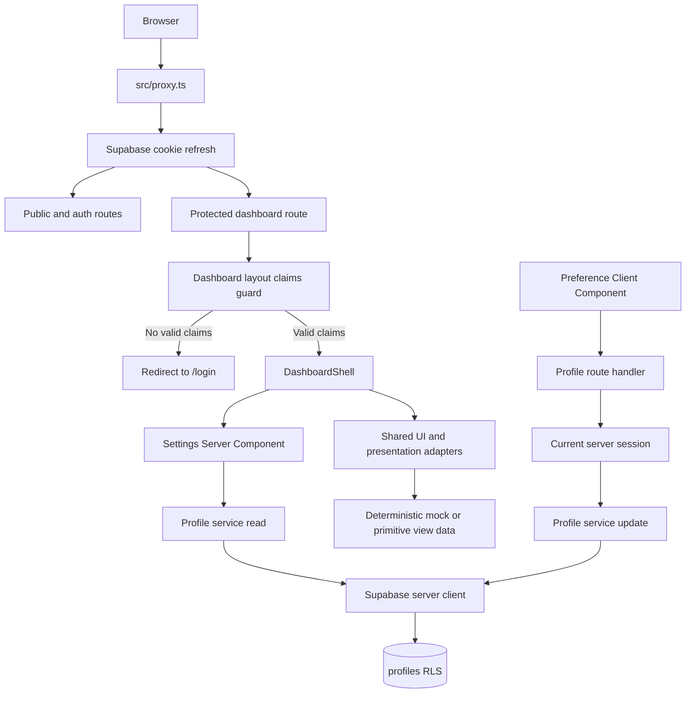

# Phase 1 Platform Foundation Design

## Overview

Phase 1 strengthens the existing Next.js 16 App Router and Supabase foundation without taking ownership of Person 2's analysis payload. The implementation keeps the current repository organization under `src/app`, `src/components`, `src/features`, and `src/lib`. It adds a server-owned profile preference flow, hardens the existing authentication boundaries, consolidates reusable presentation and accessibility primitives, and makes the existing validation commands and security checks repeatable.

The design is deliberately limited to work that can proceed while the `Analysis_Contract` remains proposed. Status, severity, and certainty values are treated as opaque inputs to view adapters. The adapters own display labels, neutral fallback behavior, and non-color visual cues, but they do not add fields to `src/contracts`, change the meaning of contract values, or validate the unresolved analysis payload.

### Design goals

- Keep authentication and authorization decisions on the server and in Supabase RLS.
- Continue using Next.js 16's `proxy.ts` convention for session-cookie refresh, while treating Proxy as an optimistic request helper rather than the authorization boundary.
- Derive profile ownership only from the current authenticated Supabase session.
- Provide exactly English, Filipino, and Taglish as user-facing language choices, with English stored as `en` by default.
- Keep interactive browser behavior in small Client Components and keep data access, secrets, and session checks in Server Components, route handlers, or server-only services.
- Make the shared UI useful to later document workflows without requiring a document, analysis record, Lumen request, or finalized analysis schema.
- Preserve existing contract tests and all current ownership, lifecycle, evidence, status, severity, certainty, and schema assertions.

### Research and repository findings

The design was informed by the installed Next.js 16 documentation and the current repository implementation:

- `AGENTS.md` requires using the Next.js guidance installed under `node_modules/next/dist/docs/` before changing Next.js code.
- The installed Next.js 16 guide at `node_modules/next/dist/docs/01-app/01-getting-started/16-proxy.md` confirms that Middleware is now named Proxy. It also says Proxy is appropriate for optimistic redirects and cookie work, not as a full session-management or authorization solution.
- The installed server/client component guides at `node_modules/next/dist/docs/01-app/01-getting-started/05-server-and-client-components.md` and `node_modules/next/dist/docs/01-app/02-guides/server-and-client-boundary.md` require deliberate boundaries. Server Components can access databases and secrets; Client Components should be limited to state, event handlers, and browser APIs, and all props crossing the boundary must be serializable.
- The current `src/proxy.ts` delegates to `src/lib/supabase/middleware.ts`, which refreshes Supabase cookies but does not make route authorization decisions. The current dashboard layout calls `supabase.auth.getClaims()` and redirects to `/login`, which is the correct place to retain the authoritative protected-route check.
- The initial database migration already creates a profile row from the `auth.users` trigger, enables RLS on `profiles`, restricts profile access to `auth.uid()`, and applies owner or explicit-share policies to the later document tables and private Storage bucket.
- The current `src/contracts` files and `src/contracts/contracts.test.ts` are a shared proposal and an existing integrity suite. Phase 1 must consume those values through view props or adapters and must not revise them.
- The existing package scripts already provide single-run `typecheck`, `lint`, `format:check`, `test`, and `build` commands. Vitest already uses the `@` alias and a Node environment.

The relevant official documentation links are [Next.js Server and Client Components](https://nextjs.org/docs/app/getting-started/server-and-client-components), [Next.js Proxy](https://nextjs.org/docs/app/getting-started/proxy), and [Next.js Authentication](https://nextjs.org/docs/app/guides/authentication). The installed copies are the version-specific source of truth for this repository.

## Architecture

### Existing architecture audit and safe improvements

The current architecture is retained with these changes:

| Existing boundary                                      | Decision                            | Safe improvement                                                                                                                                                                                                  |
| ------------------------------------------------------ | ----------------------------------- | ----------------------------------------------------------------------------------------------------------------------------------------------------------------------------------------------------------------- |
| `src/proxy.ts` and `src/lib/supabase/middleware.ts`    | Retain                              | Keep Proxy focused on refreshing Supabase cookies for matched requests. Do not move database reads, profile loading, or full authorization into Proxy.                                                            |
| `src/app/(dashboard)/layout.tsx`                       | Retain as authoritative route guard | Continue checking the current server-side claims before rendering `DashboardShell`. Redirect without rendering private children when claims are missing or expired. Preserve the existing Suspense loading shell. |
| `src/lib/supabase/server.ts`                           | Retain                              | Continue using `createServerClient` with request cookies and safe cookie writes. All server profile access uses this client.                                                                                      |
| `src/features/authentication/services/authenticate.ts` | Retain browser auth API             | Keep Supabase browser auth calls in the existing feature service, but normalize provider failures into safe user-facing categories and never expose raw provider or credential details.                           |
| `src/features/authentication/components/auth-form.tsx` | Retain Client Component             | Keep local form state and pending state in the browser. Render a stable alert for failure and a status message for registration confirmation. Preserve retry and correction actions.                              |
| `src/components/shared/sign-out-button.tsx`            | Retain Client Component             | Handle sign-out errors with the shared alert presentation. On success, navigate to `/login` and refresh the route tree.                                                                                           |
| `src/app/(dashboard)/settings/page.tsx`                | Replace placeholder content         | Make the page a server-rendered settings page that loads the current user's profile through the profile service and composes a small client preference form.                                                      |
| `src/contracts`                                        | Do not change                       | Add no fields, schema revisions, or validation rules. Presentation adapters receive primitive category/value inputs instead.                                                                                      |

### Server and client boundary

Pages and layouts remain Server Components by default. The server owns:

- Session and claims checks for protected routes.
- Profile reads and writes through a server-only service and the Supabase server client.
- Route-handler responses and HTTP status mapping.
- Environment parsing for `SUPABASE_SERVICE_ROLE_KEY` and all future Lumen variables.
- Error sanitization before any value crosses into a Client Component.
- Mock preview data selection when a foundation preview is rendered.

Client Components are limited to:

- Auth form field state, submit pending state, and retry interaction.
- Sign-out button interaction.
- The preferred-language selection and save state.
- Mobile navigation open/close state and focus return.
- Any status announcement that changes in response to a browser event.

Only serializable profile values, display labels, status descriptors, and safe messages cross the boundary. No Supabase client with service credentials, provider response, session token, raw database error, or Lumen configuration crosses the boundary. This follows the installed Next.js server/client boundary guidance.

### Request and data flow

1. Proxy refreshes the Supabase session cookies and returns the request. It does not decide whether a private route may render.
2. A protected route enters the dashboard layout. The layout checks server-side claims before rendering `DashboardShell` or any private child route.
3. The settings Server Component obtains the profile associated with the current session. The server passes only the supported language value and safe display data to the client preference form.
4. The preference form submits to a profile route handler. The handler obtains the session itself, ignores any client owner field, validates the language, and delegates to the server-only profile service.
5. Supabase RLS applies the final database authorization check. The service updates only the current user's profile row.
6. Shared previews use local mock or primitive view data. No Phase 1 preview calls Lumen or writes document-domain records.

### Protected-route behavior

The dashboard layout remains the authoritative protection point for every route inside `src/app/(dashboard)`. It must check the current server session before rendering private content:

- Missing claims redirect to `/login` before the private shell or route content is returned.
- An expired or invalid session follows the same path. The server client and Proxy refresh logic are allowed to update cookies; the layout still performs the final check.
- The redirect may carry a non-sensitive reason such as `session-expired` so the login UI can explain why the user returned. It must not include tokens, provider errors, or private route data.
- The login page displays a generic session-expired message and a normal sign-in action when that reason is present.
- The layout does not rely on a client-only auth context, because that would permit private HTML to be rendered before the client checks the session.

### Authentication flow

The existing Supabase browser client remains the provider interface for registration, sign-in, and sign-out. The service validates credentials with Zod before calling Supabase. Provider errors are translated into stable categories such as invalid credentials, account confirmation required, account already exists, and temporary failure. The UI shows a correction or retry action without echoing raw provider text.

Registration continues to show an email-confirmation status when Supabase requires confirmation. Successful sign-in navigates to `/dashboard`, followed by a refresh so the server layout evaluates the newly established session. Successful sign-out clears the Supabase session, navigates to `/login`, and refreshes. Failed sign-out remains on the current page and exposes a safe retryable alert.

## Components and Interfaces

The following modules use the current repository conventions. The paths describe implementation ownership and responsibilities; they do not introduce a new application architecture.

### Authentication and session modules

#### `src/proxy.ts`

- Remains the single Next.js 16 Proxy entry point.
- Retains the current matcher for application routes and static assets.
- Delegates only cookie/session refresh to `updateSession`.
- Does not load profiles, call Lumen, or authorize document access.

#### `src/lib/supabase/middleware.ts`

- Continues to construct the Supabase SSR client from public environment values.
- Preserves request and response cookie propagation during refresh.
- Returns the response even when there is no authenticated session; route layouts and route handlers make the authoritative decision.
- Does not log cookie values, claims, or provider error details.

#### `src/app/(dashboard)/layout.tsx`

- Remains a Server Component with a Suspense fallback.
- Calls the server Supabase client and checks claims before rendering `DashboardShell`.
- Redirects unauthenticated and expired sessions to `/login`.
- Renders no private child content on a failed session check.

#### `src/features/authentication/services/authenticate.ts`

- Keeps the browser-only provider calls for `signIn`, `register`, and `signOut`.
- Validates input before provider calls.
- Maps provider failures to a small safe error type or stable message key.
- Does not include credentials, access tokens, refresh tokens, raw response bodies, or environment values in thrown errors.

#### `src/features/authentication/components/auth-form.tsx`

- Keeps `use client` because it owns field state, submission, pending state, and retry interaction.
- Associates every field and message with accessible labels and error identifiers.
- Uses `role="alert"` for failures and `role="status"` for confirmation or progress messages.
- Keeps focus on the active form control after an asynchronous result unless the user explicitly chooses a navigation action.

#### `src/components/shared/sign-out-button.tsx`

- Keeps `use client` for pending state and navigation.
- Supplies an accessible name when an icon-only variant is used.
- Uses the shared form feedback primitive for a failed sign-out rather than displaying an unhandled provider exception.

### Profile and preferred-language modules

#### `src/features/profile/types.ts`

Defines the platform-owned language vocabulary and display mapping:

| UI label | Stored value | Meaning                                   |
| -------- | ------------ | ----------------------------------------- |
| English  | `en`         | Default Filipino-friendly English setting |
| Filipino | `fil`        | Filipino explanation preference           |
| Taglish  | `taglish`    | Taglish explanation preference            |

This vocabulary belongs to the profile feature, not the analysis contract. The profile feature may export the union and the ordered options for the settings UI. It must not import or extend an unresolved analysis payload type.

#### `src/features/profile/schemas/preferred-language.ts`

- Validates only `en`, `fil`, and `taglish`.
- Rejects all other strings before a database mutation.
- Provides safe field-level validation text for the settings form.
- Treats the database default as `en` when a new profile has no explicit saved value.

#### `src/features/profile/services/profile-service.ts`

A server-only service that exposes operations equivalent to:

- `getCurrentProfile()`: obtains the current session from the server Supabase client, derives the authenticated user ID from the session claims, and reads only that user's profile.
- `updateCurrentPreferredLanguage(language)`: validates the language, obtains the current session again, and updates only `preferred_language` for the authenticated user. The operation accepts no owner ID.
- `ensureCurrentProfile()`: returns the existing profile or reports a controlled missing-profile condition. Account creation remains backed by the existing `auth.users` trigger; this function is not a client-controlled upsert.

The service must use `server-only` or an equivalent server-only import boundary. It does not accept `user_id`, `owner_id`, or a profile primary key from the browser. RLS remains the second authorization boundary even though the service derives the ID from the session.

#### `src/app/api/profile/route.ts`

A route handler for the client preference form:

- `GET` returns the current authenticated user's safe profile settings, or `401` if there is no valid session.
- `PATCH` accepts only a preferred-language value. Any extra owner identifier is ignored for authorization and does not change the target row.
- `PATCH` returns `400` for an unsupported language, `401` for no valid session, and a generic `500` response for an unexpected persistence failure.
- The response includes no service-role data, session token, raw database error, or unrelated profile fields.
- The handler delegates all database access to the profile service and sets appropriate no-store behavior for per-user data.

#### `src/app/(dashboard)/settings/page.tsx` and profile UI

- The page remains a Server Component and loads the current user's saved language before rendering.
- A focused Client Component, located under `src/features/profile/components/`, renders exactly three radio or select choices and submits the selected value.
- The form uses the server-provided initial value and does not infer ownership from URL parameters or hidden inputs.
- Save success is announced with `role="status"`; validation and persistence failures use `role="alert"`.
- The control remains usable at 320 CSS pixels without horizontal scrolling.

#### Database migration and types

A Phase 1 migration will apply only the profile preference constraint needed by this design:

- Normalize any existing unsupported `preferred_language` values to `en` before adding the allowed-value check.
- Enforce `preferred_language in ('en', 'fil', 'taglish')` at the database layer.
- Preserve the existing `profiles.id` primary key and foreign key to `auth.users`.
- Preserve the existing `handle_new_user` trigger, so account creation creates one profile with the database default.
- Do not apply the unresolved domain-model proposal as part of this phase and do not modify analysis tables or contract fields.

The generated database type file remains synchronized with the applied schema through the existing `npm run db:types` workflow. The feature-level language type remains the stable UI boundary even if generated Supabase types continue to represent text columns broadly.

### Shared UI primitives

The existing primitives under `src/components/ui` remain the base layer. Phase 1 completes or extends the following independent primitives without making them document-specific:

- `Button`: keyboard-visible focus, disabled and pending states, safe `asChild` use, and accessible text or name.
- `Input`: label association, invalid state, description and error linkage, and visible focus.
- `Label`: consistent association with controls.
- `Card`: structural grouping with heading and description support.
- `Badge`: compact text plus a non-color cue.
- `Separator`: decorative or semantic separation as appropriate.
- `FormMessage`: shared status and alert rendering with stable `role` behavior.
- `LoadingState`: status announcement with a visually quiet skeleton.
- `EmptyState`: heading, explanation, and optional action for no-content previews.

The current `src/components/ui/button.tsx` and `input.tsx` already include focus-visible styling. The implementation will make focus treatment and contrast consistent across every primitive rather than adding one-off page styles.

### Generic presentation adapters

Presentation belongs in a platform-owned adapter layer, for example `src/lib/presentation` plus a reusable component under `src/components/ui`. The adapter contract is view-oriented:

- Input: a display category (`status`, `severity`, or `certainty`) and an opaque raw value supplied by a caller.
- Output for a supported value: a display label, a category label, a neutral or semantic tone, and at least one non-color cue such as an icon, symbol, text prefix, or shape.
- Output for an unsupported value: `Unknown value`, a neutral treatment, no category label, and no exception that disrupts surrounding UI.

The adapter may map known strings from current or future contracts, but it must not import a schema solely to redefine it. It does not own `status`, `severity`, or `certainty` enums, add fields to `src/contracts/analysis.ts`, or validate an analysis report. Later report, processing, evidence, correction, chat, reminder, or sharing views can pass their values through the same primitive props or adapter.

The rendered component separates the category from the label in accessible text, for example a category region followed by a value label. Color is supplementary only. The label and cue remain understandable in grayscale and with color-vision differences.

### Layout, accessibility, and responsive modules

#### Landmarks and headings

- `src/app/page.tsx`, `src/app/(auth)/layout.tsx`, and `src/components/layout/dashboard-shell.tsx` each own exactly one page-level `main` landmark for the rendered route. Nested `main` landmarks are removed.
- Every page keeps or adds one meaningful `h1`, including settings, login, registration, dashboard, documents, and public fallback pages.
- `Sidebar` and mobile navigation use explicitly labeled `nav` landmarks. Repeated navigation landmarks receive distinct accessible labels when both desktop and mobile variants are present.
- The dashboard header remains a `header` landmark and does not replace the page heading.

#### Keyboard and asynchronous status behavior

- All interactive controls use native links, buttons, inputs, or labeled form controls before adding custom behavior.
- Focus-visible styles are consistent and meet the non-color focus requirement. No positive `tabindex` is introduced.
- Mobile navigation exposes its expanded state, controls the overlay, returns focus to its trigger on close, and prevents hidden menu content from remaining in the tab order.
- Loading and success messages use `role="status"` with a polite announcement. Errors use `role="alert"` and are associated with the affected control when applicable.
- Async form updates do not call focus-changing navigation as a side effect. A successful save preserves focus on the language control; an error preserves focus on the submitted control.

#### Responsive layout and contrast

- Existing `min-w-0`, max-width, grid, and breakpoint patterns remain the base.
- Settings forms, authentication cards, navigation, and foundation previews use fluid widths and wrapping rather than fixed desktop widths.
- The design is checked at 320, 375, 768, 1024, and 1440 CSS pixels. No required control or primary navigation depends on horizontal scrolling in that range.
- Text, focus rings, borders, disabled states, and essential non-text controls are selected against WCAG 2.2 AA contrast thresholds. Color-only status meaning is prohibited.
- Icon-only controls always receive an explicit accessible name, as already done for the mobile menu buttons and navigation brand link.

## Data Models

### Profile model

The existing `public.profiles` row remains the persistence model:

| Field                      | Phase 1 behavior                                                                       |
| -------------------------- | -------------------------------------------------------------------------------------- |
| `id`                       | Auth user UUID and ownership key. Taken from the current session only.                 |
| `full_name`                | Read-only or untouched in this phase unless already needed by the existing account UI. |
| `preferred_language`       | Stored code `en`, `fil`, or `taglish`; database default `en`.                          |
| `created_at`, `updated_at` | Database-managed timestamps.                                                           |

The client never supplies `id` as an authorization input. A profile query is scoped by the server Supabase client and RLS. A language update sends only the validated language field.

### View-level presentation model

The presentation adapter uses a small view descriptor rather than an analysis model:

| Field       | Purpose                                                                                        |
| ----------- | ---------------------------------------------------------------------------------------------- |
| `category`  | View category used to render `Status`, `Severity`, or `Certainty`; omitted for unknown values. |
| `label`     | Human-readable value label. Unknown values use `Unknown value`.                                |
| `cue`       | Non-color text, icon, or symbol used as a redundant visual cue.                                |
| `tone`      | Optional neutral or semantic styling hint, never the only meaning.                             |
| `supported` | Internal adapter result used to choose normal or unknown rendering.                            |

This model is not persisted, is not added to `src/contracts`, and is not a replacement for the future analysis JSON schema.

### Mock preview model

Foundation previews use deterministic local data with an explicit `isMock` or `contentLabel` presentation boundary. A preview may contain a title, sample status descriptor, sample severity descriptor, or sample certainty descriptor, but it must be visibly labeled `Sample` or `Mock data`. It has no document ID, analysis ID, storage path, provider credentials, Lumen request metadata, or persistence operation.

Existing files under `src/mocks/analysis` may remain as contract fixtures for the retained contract tests. A foundation preview must either use primitive view data or pass an existing mock through a read-only adapter. It must not make the mock look like a completed user analysis.

## Error Handling

### Authentication and session errors

- Missing claims, invalid claims, and expired sessions all resolve to the login redirect from the protected layout.
- Login and registration use stable, user-safe messages. The UI may say that credentials could not be verified or that the account needs confirmation, but it must not display raw provider response bodies.
- Supabase network or configuration failures show a generic retry message and do not log credentials, tokens, cookies, or environment values.
- Sign-out failure leaves the user in place, announces the failure, and keeps the button retryable. A successful sign-out always routes to `/login`.
- The dashboard error boundary continues to show a generic retry view. Server error details remain server-side and are not interpolated into client markup.

### Profile errors

- Unsupported language input returns a validation error and leaves the stored profile unchanged.
- Missing or expired session returns `401` and leaves the profile unchanged.
- A profile query or update that is rejected by RLS returns a generic authorization or unavailable response. The response does not disclose whether another user's profile exists.
- Missing profile rows are handled as a controlled setup state. The service may report that the profile is unavailable, but it must not create a row using a client-provided owner ID.
- Unexpected database failures return a generic persistence error, preserve the previous UI selection when possible, and never expose SQL, policy, or provider details.

### Presentation fallback errors

An unsupported status, severity, or certainty value is normal input at the adapter boundary, not an application exception. The adapter renders `Unknown value`, a neutral non-color cue, and no category label. The surrounding card, page, and other values continue rendering.

### Validation command errors

Each existing single-run command remains responsible for its own exit code. The command output must identify the failed check through the tool's normal output. If a repository-level aggregate command is added later, it must run the five checks sequentially and stop with a nonzero result when any check fails; it must not hide the original command output.

## Security and ownership design

### Profile authorization

1. The profile route handler obtains the current session on the server.
2. The profile service derives the authenticated user ID from the verified session claims.
3. The service issues a query or update against that ID only. There is no client-controlled owner or profile ID parameter.
4. Supabase RLS requires `profiles.id = auth.uid()` for reads and writes.
5. A mismatched client owner field, if sent by a malicious caller, is ignored for authorization and cannot select another row. The request remains scoped to the authenticated session and is rejected if it attempts an unsupported operation.

### Database and storage audit

The security audit records a pass/fail result and evidence for:

- `profiles` RLS enabled, owner-only select, owner-only update, and the language constraint.
- `documents`, `document_analyses`, `document_tasks`, `document_shares`, and `processing_jobs` RLS policies remaining owner- or explicit-share-scoped.
- Private `documents` Storage bucket and owner path policies remaining intact.
- The signed-URL route continuing to authorize document ownership or explicit sharing before using any service-role operation.
- The `handle_new_user` trigger creating exactly one profile per new auth user.
- No Phase 1 route creating, updating, or deleting document analysis, OCR, evidence, correction, conversation, reminder, or sharing records.

The audit record identifies the migration file, route and service modules, policy names, and automated tests used to verify each result. It is a security review artifact, not a new runtime authorization mechanism.

### Secret handling

- `NEXT_PUBLIC_SUPABASE_URL` and `NEXT_PUBLIC_SUPABASE_ANON_KEY` may be used by browser and server Supabase clients because they are public Supabase values.
- `SUPABASE_SERVICE_ROLE_KEY` remains restricted to server-only modules and is not needed by the profile flow.
- `LUMEN_API_KEY`, `LUMEN_API_BASE_URL`, and `LUMEN_MODEL` remain optional server-only placeholders. Phase 1 does not read them in client code and does not call Lumen.
- `src/lib/env/server.ts` remains protected by `server-only`. No Client Component imports it directly or indirectly.
- User-facing errors, rendered markup, test snapshots, and application logs exclude secret values, tokens, raw provider responses, private document contents, and full database errors.

## Testing Strategy

### PBT applicability decision

Property-based testing is not used for this phase's primary acceptance suite. The feature is dominated by UI rendering, authentication and database integration, simple profile CRUD, configuration validation, and side-effect-only route behavior. Those areas are better covered by focused examples, mocked service tests, route-handler tests, static accessibility assertions, and local Supabase security checks than by generating large numbers of external-session or UI cases.

The language mapping and presentation adapter are deterministic pure logic, but their required cases are a small closed vocabulary plus an unknown-value fallback. Example-based tests cover those cases more directly and preserve the existing Vitest setup without introducing a separate property-testing framework. Therefore this design intentionally omits a Correctness Properties section.

### Unit and example tests with Vitest

The existing `vitest.config.mts` remains the test entry point with the `@` alias and Node environment. Add focused tests under the same `src/**/*.test.ts` and `src/**/*.test.tsx` convention:

- Preferred-language schema accepts `en`, `fil`, and `taglish` and rejects an unsupported value.
- Language option order and labels expose exactly three choices.
- Profile service derives the owner from the mocked current session and never forwards a client owner ID.
- Profile service preserves the previous value after invalid input or failed persistence.
- Profile route returns `401` without a session, `400` for an unsupported language, and a safe success response for a valid current-user update.
- A mismatched owner input cannot read or update another user's profile.
- Protected layout authorization logic redirects when claims are missing and renders the shell when claims are present. The test uses a mocked Supabase server client and does not require a production account.
- Auth failure mapping returns safe messages and does not include credentials, tokens, or raw secret-bearing provider text.
- Sign-out success and failure produce the correct navigation or retryable feedback behavior.
- Presentation adapters render the category and value label for supported values, include a non-color cue, and render the neutral `Unknown value` fallback without a category for unsupported values.
- Shared feedback primitives render loading and success as status announcements and errors as alert announcements.
- Icon-only controls expose accessible names.
- Page and shell markup has one main landmark, a meaningful heading, and labeled navigation landmarks. Static server rendering can verify these semantics without a browser test runner.

The existing `src/contracts/contracts.test.ts` remains unchanged and runs in the same `npm test` command. Its assertions continue to cover analysis evidence integrity, lifecycle transitions, status, severity, certainty, and schema behavior.

### Integration and security tests

When a local Supabase instance is available, integration checks should verify:

- A newly created auth user receives exactly one profile with `preferred_language = 'en'`.
- The owner can read and update the owner's profile.
- A different authenticated user cannot read or update the first user's profile.
- An unauthenticated request cannot access profile data.
- Profile RLS is enabled and the language check rejects unsupported values.
- Existing document, analysis, task, share, processing-job, and Storage policies still enforce owner or explicit-share access.

These checks use local fixtures or mocked sessions and never contact Lumen or require a production account. If the local database is unavailable, the pure service and policy-shape tests still run, while the validation output identifies the unavailable integration environment rather than silently skipping required assertions.

### Accessibility and responsive verification

- Static component assertions verify landmark count, heading presence, navigation labels, message roles, focus-visible classes, and icon-only names.
- Manual or browser-level verification checks 320, 375, 768, 1024, and 1440 CSS pixel widths, keyboard traversal, mobile navigation focus return, async message announcements, and no horizontal scrolling.
- Contrast review checks normal text at 4.5:1 or higher, large text at 3:1 or higher, and essential non-text controls at 3:1 or higher. The status, severity, certainty, and focus cues must remain understandable without color.

### Validation commands

The repository-designated commands remain single-run and non-interactive:

| Check                   | Command                |
| ----------------------- | ---------------------- |
| Strict TypeScript       | `npm run typecheck`    |
| Lint                    | `npm run lint`         |
| Formatting verification | `npm run format:check` |
| Unit and contract tests | `npm run test`         |
| Production build        | `npm run build`        |

The supported runtime remains Node.js `>=20.9.0`. CI and local validation use placeholder values for required environment variables. Tests mock Supabase and provider boundaries and make no Lumen network request. The production build must not require a live Supabase user, real document, real analysis payload, or Lumen credentials.

## Requirement traceability

| Design element                                                             | Requirements covered    |
| -------------------------------------------------------------------------- | ----------------------- |
| Proxy cookie refresh plus server dashboard claims guard                    | 1.1, 1.2, 1.5, 1.6, 7.5 |
| Safe authentication error mapping, retryable auth UI, sign-out flow        | 1.3, 1.4, 5.4, 7.5      |
| Profile service, route handler, language schema, current-session ownership | 2.1–2.7, 5.3, 7.1, 7.4  |
| Profile migration, trigger preservation, and RLS checks                    | 2.2, 2.5–2.7, 7.2, 7.3  |
| Shared UI primitives and generic presentation adapter                      | 3.1–3.6, 4.2, 4.5–4.6   |
| Server/client split and no contract changes                                | 3.5, 6.4–6.5, 7.5       |
| Landmarks, headings, focus, announcements, responsive layout, contrast     | 4.1–4.6                 |
| Vitest unit, route, contract, and security checks                          | 5.1–5.6, 7.2–7.6        |
| Mock preview boundary and explicit sample labeling                         | 6.1–6.3, 6.5            |
| Ownership, RLS, private Storage, and secret audit                          | 7.1–7.6                 |

## Scope boundary and deferred work

This design does not design or implement document upload, vault behavior, OCR submission or polling, processing-stage screens, classification, report sections, evidence navigation, OCR correction, document-grounded chat, reminders, cross-document analysis, family sharing, Lumen provider code, production analysis orchestration, or any redesign/versioning of the `Analysis_Contract`.

Phase 1 may expose the shared primitives, generic presentation adapter, mock preview boundary, and profile language value needed by those later phases. Later work must consume those interfaces without assuming that Phase 1 has defined the final analysis JSON shape or created real analysis-domain records.
