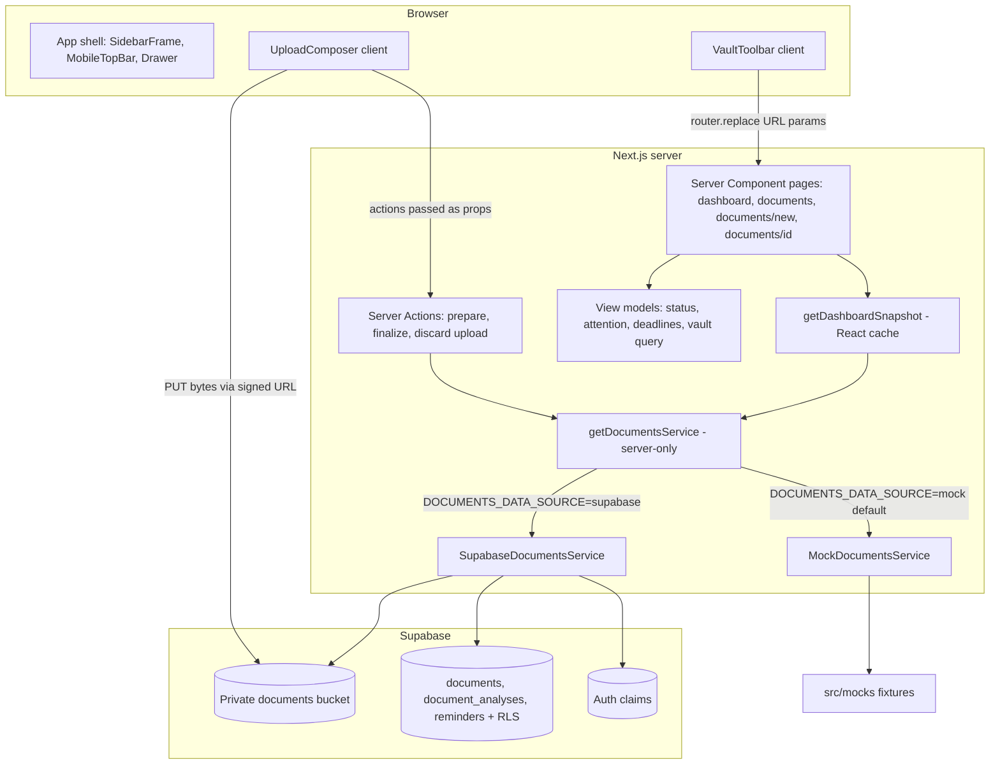
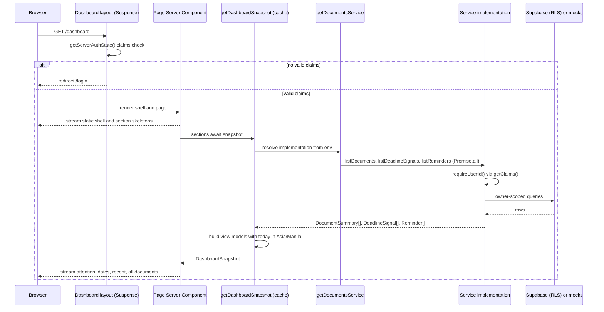
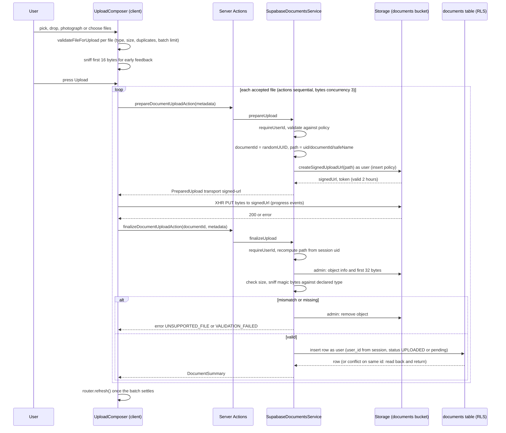
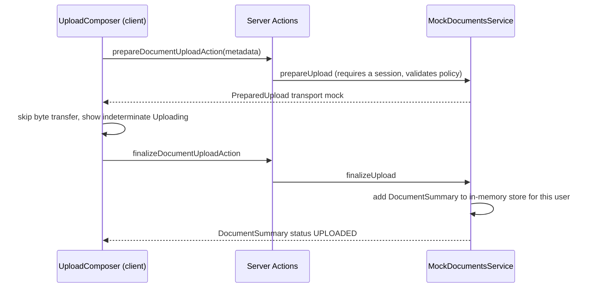
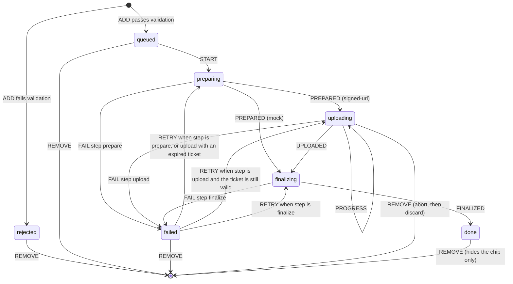

# Design Document: Phase 2 Documents and Dashboard

## Overview

Phase 2 delivers Person 1's product.md §17 tasks 3, 4 and 5: the document upload interface, the document vault, and the dashboard. It builds on the Phase 1 foundation on branch `feature/platform` (Supabase auth, server-side route guard, profile language, shared UI primitives, presentation adapter, accessibility baseline). It also introduces a visual design system modeled on modern AI assistant products (Claude, ChatGPT, Meta AI): a calm warm-neutral canvas, a collapsible conversation-history-style sidebar, and an upload "composer" that behaves like a chat input box.

All document data flows through one server-only `DocumentsService` interface with two implementations. The **mock** implementation is the default and is backed by `src/mocks`. The **Supabase** implementation uploads the original file to the private `documents` bucket and registers a `documents` row with status `UPLOADED`. A server-only environment flag selects the implementation. UI code never imports `src/mocks` and never imports a service implementation directly. The shared contracts in `src/contracts` are consumed read-only. Every value the UI needs that the contract does not provide lives in a view model under `src/features/documents/view-models` or `src/features/dashboard`.

Phase 2 never calls Lumen, never triggers OCR or analysis, never shows a processing percentage, and never renders a report. It may link to `/documents/[documentId]`, which shows a placeholder detail page with the document's facts and status only.

### Scope

| In scope (Phase 2)                                                                                     | Out of scope (later phases)                                           |
| ------------------------------------------------------------------------------------------------------ | --------------------------------------------------------------------- |
| Upload: file picker, drag and drop, camera capture, gallery, multiple files, per-file state, retry, remove | Processing-stage screen and live status (Phase 3)                     |
| Client and server file validation (PDF, JPEG, PNG, TIFF, WebP; 10 MiB each)                            | Report view, evidence navigation (Phase 4)                            |
| Supabase upload path: Storage object plus `documents` row with status `UPLOADED`                       | OCR submission, polling, retry of OCR or analysis (Person 2)          |
| Vault: list, search, category and status filters, sort, empty/loading/error states                     | OCR correction, chat, language switching of reports                   |
| Dashboard: attention, deadlines and reminders, recently analyzed, all documents                        | Reminder create/edit/delete, sharing, cross-document analysis         |
| Placeholder `/documents/[documentId]` page                                                             | Document delete, rename, recategorize                                 |
| App shell redesign, design tokens, fonts, light and dark mode                                          | Manual theme toggle UI and large-text toggle UI (token support only)  |

### Research and repository findings

These findings come from reading the repository and the installed Next.js 16.4.6 documentation under `node_modules/next/dist/docs/`.

- `next.config.ts` enables `cacheComponents: true` and `partialPrefetching: true`. The installed guide `01-app/02-guides/authentication-with-cache-components.md` says a request read (cookies, session) cannot be part of the static shell and must sit behind `<Suspense>`. Reading `cookies()` outside a boundary is a build error. The existing `src/app/(dashboard)/layout.tsx` already wraps the claims check in `<Suspense>`.
- `01-app/03-api-reference/05-config/01-next-config-js/serverActions.md` states the default Server Action request body limit is 1 MB. A 10 MiB file cannot pass through a Server Action without raising `bodySizeLimit`, and a Vercel function request body is capped at about 4.5 MB regardless. File bytes therefore go directly from the browser to Supabase Storage through a signed upload URL. Server Actions carry only small JSON metadata.
- `01-app/01-getting-started/07-mutating-data.md` says Server Actions are reachable by direct POST, so every action must re-check authentication. It also documents that the client dispatches Server Actions one at a time, and that `refresh()` from `next/cache` refreshes the client router after a mutation.
- `01-app/03-api-reference/04-functions/catchError.md` documents `catchError` from `next/error` (stable since 16.3). It creates a component-level error boundary with `retry()`. Phase 2 uses it to isolate dashboard sections.
- `01-app/03-api-reference/03-file-conventions/dynamic-routes.md` confirms `params` is a `Promise` and pages can be typed with `PageProps<'/documents/[documentId]'>`.
- `01-app/01-getting-started/13-fonts.md` documents `next/font/google` (for example `Geist`) with a CSS `variable` option for Tailwind.
- `node_modules/@supabase/storage-js/dist/index.cjs` shows `createSignedUploadUrl(path)` requires the `objects` insert permission, returns `{ signedUrl, path, token }`, and is valid for 2 hours. `uploadToSignedUrl` sends a `PUT` to `/object/upload/sign/<bucket>/<path>?token=…` with `x-upsert: false`. It uses `fetch`, which has no upload progress events.
- `supabase/migrations/20261112000000_initial_schema.sql` (applied) allows MIME `application/pdf`, `image/jpeg`, `image/png`, `text/plain` and lowercase statuses `uploading`, `pending`, `processing`, `completed`, `failed`. Storage insert policy: first folder segment must equal `auth.uid()`. Storage select policy: a `documents` row with `storage_path = name` and `user_id = auth.uid()` must already exist. The `documents.storage_path` check requires the path to start with `user_id || '/'`.
- `supabase/migrations/20261113000000_domain_model_proposal.sql` (committed, not agreed with Person 2, not applied) adds `image/tiff`, `image/webp`, the uppercase §13 lifecycle, `title`, `category`, `subtype`, `page_count`, `failure_reason`, versioned `document_analyses.report_json`, and the `reminders` table.
- `src/contracts/api.ts` `DocumentSummary.deadlines` is `{ title, date }[]` with no `informationStatus`. `AnalysisResult.importantDates[]` (in `src/contracts/analysis.ts`) does carry `informationStatus`, a nullable `date`, and `dateType`. The government notice mock has two `DEADLINE` dates marked `CONFLICTING`.
- `src/security/server-secret-boundary.test.ts` walks the import graph of every `"use client"` module. It fails if a client graph reaches `server-only`, `@/lib/env/server`, `@/lib/supabase/admin` or `@/lib/ai`. It also fails if any application file contains `console.*` or if a `.tsx` file renders `error.message`. Phase 2 must respect all three rules.
- `src/features/profile/services/profile-service.ts` establishes the server-only service pattern: derive the user id from `supabase.auth.getClaims()`, never accept an owner id, map failures to coded errors with safe messages.
- `src/lib/presentation/index.ts` already provides `PresentationTone` (`neutral`, `positive`, `informative`, `caution`, `critical`). Phase 2 reuses that tone vocabulary and does not edit the adapter.
- `src/config/brand.ts` currently sets `brand.name` to `"Document AI"`. product.md uses the working name "Kalinga AI". The design reads `brand.name` everywhere and does not hardcode either value.

## Architecture

### High-level structure



### Boundaries

| Boundary                    | Rule                                                                                                                                                                                                                          |
| --------------------------- | ----------------------------------------------------------------------------------------------------------------------------------------------------------------------------------------------------------------------------- |
| Contracts                   | `src/contracts` is imported read-only for types and enums. No file under `src/contracts` changes in Phase 2.                                                                                                                  |
| Mocks                       | Only `src/features/documents/services/mock-documents-service.ts` imports `@/mocks`. No component, page, action or view model imports `@/mocks`. A test enforces this.                                                          |
| Service selection           | `getDocumentsService()` is `server-only`. It reads `DOCUMENTS_DATA_SOURCE` through a new documents env module. Callers depend only on the `DocumentsService` interface.                                                       |
| Server and client           | Pages, sections, rows and the detail page are Server Components. Client Components are limited to the composer, vault toolbar, sidebar frame, mobile drawer, nav links, account menu and section error boundary.               |
| Server Actions in client UI | Client Components never import the actions module. Server Component pages import the actions and pass them as props. This keeps `server-only` service code out of client import graphs, which the secret-boundary test checks. |
| Authorization               | Proxy (`src/proxy.ts`) only refreshes the session. The dashboard layout guard, every service method and every Server Action re-derive the user id from `getClaims()`. Supabase RLS is the final check.                        |
| Lumen                       | No Phase 2 module imports `@/lib/ai` or any Lumen configuration.                                                                                                                                                              |

### Data source and schema profile selection

Two independent server-only flags control data access:

| Variable                   | Values                       | Default     | Effect                                                                                                                         |
| -------------------------- | ---------------------------- | ----------- | ------------------------------------------------------------------------------------------------------------------------------ |
| `DOCUMENTS_DATA_SOURCE`    | `mock`, `supabase`           | `mock`      | Selects the `DocumentsService` implementation. Any value other than exactly `supabase` (case-insensitive, trimmed) means mock. |
| `DOCUMENTS_SCHEMA_PROFILE` | `initial`, `lifecycle`       | `initial`   | Supabase only. Declares which migration is applied, so the service selects matching columns, statuses and MIME types.          |
| `DOCUMENTS_MOCK_TODAY`     | ISO date `yyyy-mm-dd`        | `2026-11-15` | Mock only. Pins "today" so the fixture deadlines (November and December 2026) render meaningfully. Ignored in Supabase mode.   |

These variables are not secrets, but they are read only in a `server-only` module (`src/lib/env/documents.ts`) so the decision cannot be made or overridden in the browser. The module must not require `SUPABASE_SERVICE_ROLE_KEY`, so mock mode works without it. `getServerEnv()` is called only by the Supabase implementation, and only in the finalize step that needs the admin client.

### Behavior under each migration

| Concern                    | `initial` profile (applied migration)                                                                                         | `lifecycle` profile (proposal migration)                                                         |
| -------------------------- | ----------------------------------------------------------------------------------------------------------------------------- | ------------------------------------------------------------------------------------------------ |
| Accepted upload types      | PDF, JPEG, PNG. TIFF and WebP are rejected on the client and server with "TIFF and WebP files aren't supported yet."          | PDF, JPEG, PNG, TIFF, WebP                                                                       |
| `text/plain`               | Not accepted by the app (product.md §5.1 lists only the five image/PDF formats), although the database still allows it.       | Same                                                                                             |
| Status written on insert   | `pending`                                                                                                                     | `UPLOADED`                                                                                       |
| Status read mapping        | `uploading` and `pending` to `UPLOADED`; `processing` to `OCR_PROCESSING`; `completed` to `COMPLETED`; `failed` to `ANALYSIS_FAILED`. This mirrors the proposal migration's own `UPDATE` so data looks the same before and after migrating. | Stored value used directly after Zod validation against `DOCUMENT_STATUSES`                      |
| `title`                    | Derived from `original_filename` without extension                                                                            | `title` column, falling back to the derived title when null                                      |
| `category`, `subtype`, `pageCount`, `failureReason` | Always `null`                                                                                      | Read from columns                                                                                |
| `latestAnalysis`           | Always `null` (the initial `document_analyses` has no `version` or `status`)                                                  | Highest `version` row per document                                                               |
| Deadlines                  | Always empty                                                                                                                  | `importantDates` of type `DEADLINE` from the latest `COMPLETED` analysis `report_json`          |
| Reminders                  | Capability off. The dashboard shows "Reminders will appear here once they're available."                                     | `reminders` table, status `PENDING` only                                                         |
| `canRetry`                 | `false` for all rows                                                                                                          | `true` for `OCR_FAILED`, `OCR_PARTIAL`, `ANALYSIS_FAILED` (as documented in `api.ts`)            |

A row whose mapped value fails `documentSummarySchema` is skipped. The vault then shows a quiet notice: "Some documents couldn't be shown right now." The service never logs (the secret-boundary test forbids `console.*`); it counts skipped rows and returns the count to the caller.

Setting `DOCUMENTS_SCHEMA_PROFILE=lifecycle` before the proposal migration is applied makes the column selects fail. The service maps that to `INTERNAL` and the page shows the generic error state. This is a deployment configuration error, listed in the handoff notes.

### Route map

| Route                      | File                                                   | Kind                                   | Purpose                                                                       |
| -------------------------- | ------------------------------------------------------ | -------------------------------------- | ----------------------------------------------------------------------------- |
| `/dashboard`               | `src/app/(dashboard)/dashboard/page.tsx`               | Server page (rewritten)                | Home: greeting, composer, attention, dates, recently analyzed, all documents  |
| `/documents`               | `src/app/(dashboard)/documents/page.tsx`               | Server page (rewritten)                | Vault with search, filters and sort through URL search params                 |
| `/documents/new`           | `src/app/(dashboard)/documents/new/page.tsx`           | Server page (new) with client composer | Focused upload screen. Target of the sidebar "New upload" action              |
| `/documents/[documentId]`  | `src/app/(dashboard)/documents/[documentId]/page.tsx`  | Server page (new)                      | Placeholder detail: title, status, facts, failure reason. No report           |
| `/settings`                | existing                                               | Server page (visual token update only) | Unchanged behavior                                                            |
| `GET /api/documents/[documentId]/signed-url` | existing route                       | Route Handler (unchanged)              | Not used by Phase 2 UI. Kept for later phases                                 |

Static segment `new` takes precedence over the dynamic `[documentId]` segment, so `/documents/new` never reaches the detail page.

### Mutations: Server Actions, not Route Handlers

Phase 2 has three mutations, all implemented as Server Actions in `src/features/documents/actions/upload-actions.ts` (`"use server"` at the top of the file):

| Action                          | Input (JSON, under 1 KB)                                   | Output                                                   |
| ------------------------------- | ---------------------------------------------------------- | -------------------------------------------------------- |
| `prepareDocumentUploadAction`   | `{ originalFilename, mimeType, fileSize }`                 | `ActionResult<PreparedUpload>`                           |
| `finalizeDocumentUploadAction`  | `{ documentId, originalFilename, mimeType, fileSize }`     | `ActionResult<{ document: DocumentSummary }>`            |
| `discardDocumentUploadAction`   | `{ documentId, originalFilename, mimeType }`               | `ActionResult<null>`                                     |

Reasons for choosing Server Actions:

1. The callers are our own Client Components. Actions give same-origin CSRF protection by default (`serverActions.allowedOrigins` docs) and typed arguments without a hand-written fetch layer.
2. The payloads are tiny. File bytes never pass through Next.js, so the 1 MB action limit and the Vercel body cap do not apply.
3. Reads happen in Server Components through the service, so Phase 2 needs no `GET /api/documents` endpoint. The product.md §14 REST endpoints (`POST /api/documents`, `GET /api/documents`, `GET /api/documents/:id`) can later be thin Route Handlers over the same `DocumentsService` when Person 2 or an external caller needs them. That is deferred.

The client dispatches actions sequentially. Prepare and finalize calls for several files therefore queue one after another, while the byte transfers (direct to Storage) run in parallel with a concurrency of 3. Prepare and finalize are fast metadata calls, so the serial queue is acceptable.

Actions return a discriminated result instead of throwing, so no raw error crosses to the client:

```typescript
type ActionResult<T> =
  | { ok: true; data: T }
  | { ok: false; error: { code: ApiErrorCode; message: string; retryable: boolean } };
```

`ApiErrorCode` comes from `src/contracts/api.ts` (read-only reuse).

After a batch settles, the composer calls `router.refresh()` once. The actions do not call `refresh()` themselves, which avoids one full re-render per file.

### Caching and Suspense strategy

- Every per-user read (`listDocuments`, `listReminders`, deadline signals, display name) reads cookies and is request-time. Each read sits inside a `<Suspense>` boundary, as Cache Components requires.
- Phase 2 does not use `use cache`, `use cache: private`, or `cacheTag` for document data. Processing status changes outside this app (Person 2's pipeline), and stale status is worse than a short wait. This can be revisited in Phase 3.
- `getDashboardSnapshot()` and `getDocumentsService()` are wrapped in React `cache()` so one request makes one set of service calls even though several sections render separately.
- Static parts of each page (page heading text that does not depend on the user, composer frame, section headings) render outside the Suspense boundaries and prerender into the static shell.
- "Today" is computed only after awaiting request data (the service call reads cookies), or after `await connection()`. Cache Components rejects reading the current time during prerendering. The implementing agent must confirm the exact rule in `01-app/01-getting-started/08-caching.md`.
- The upload policy depends only on environment flags, so it may be computed outside Suspense. Its values are fixed at build time for a given deployment.
- Phase 2 does not poll. The vault and the detail page show a "Check for updates" ghost button that calls `router.refresh()`.

## Sequence Diagrams

### Vault and dashboard read



### Upload with the Supabase implementation



### Upload with the mock implementation



The mock store lives in module memory, resets on server restart, and is per user id. Fixture documents from `src/mocks` are shown to every signed-in user alongside session uploads. The shell shows the mock banner whenever the mock source is active.

## Visual Design System

### Principles

- **Calm and content-first.** The page is mostly empty warm canvas. Content sits in one centered column. Chrome is limited to the sidebar and, on mobile, a slim top bar.
- **Quiet confidence.** One accent color, used only for the primary action and selection. No gradients, no heavy shadows, no dense tables of badges.
- **Readable for everyone.** Base text is 16px with 1.625 line height, and a large-text mode raises everything to 18px. Tap targets are at least 44 × 44 px. Every status shows an icon, a shape and a text label, so color is never the only signal.
- **Honest motion.** Transitions of 150–200 ms clarify state changes. Spinners appear only while real work is pending, never with an invented percentage.

### Color tokens

Tokens are CSS custom properties on `:root`, exposed to Tailwind v4 through `@theme inline` so utilities like `bg-canvas`, `text-ink`, `border-hairline` work. Components use only semantic token utilities, never raw `slate-*` or `dark:` classes, so dark mode and a future manual toggle need no component changes.

| Token                   | Light     | Dark      | Use                                                                 |
| ----------------------- | --------- | --------- | ------------------------------------------------------------------- |
| `--canvas`              | `#FAF9F5` | `#1C1B19` | Page background (warm ivory / warm charcoal)                        |
| `--surface`             | `#FFFFFF` | `#262522` | Cards, composer, menus                                              |
| `--surface-sunken`      | `#F3F1EA` | `#201F1D` | Sidebar, drawer, skeletons                                          |
| `--surface-hover`       | `#EBE7DD` | `#302E2A` | Row hover, active nav item background                               |
| `--border-hairline`     | `#E5E1D6` | `#3A3834` | Decorative 1px separators and card edges (never the only boundary of a control) |
| `--border-strong`       | `#8A8478` | `#8C867A` | Input and composer outline, checkbox and select borders             |
| `--ink`                 | `#1F1E1B` | `#ECE9E2` | Primary text, icons, focus outline                                  |
| `--ink-muted`           | `#5E5A52` | `#B5AFA4` | Secondary text, descriptions                                        |
| `--ink-subtle`          | `#6B665C` | `#9C968A` | Metadata (dates, file sizes)                                        |
| `--accent`              | `#A84F2D` | `#E3916F` | Primary button background, selected filter chip, drop-active border |
| `--accent-hover`        | `#8F4024` | `#EBA283` | Primary button hover                                                |
| `--on-accent`           | `#FFFFFF` | `#1C1B19` | Text and icons on `--accent`                                        |
| `--accent-ink`          | `#9A4527` | `#EBA283` | Accent-colored text and links                                       |
| `--accent-soft`         | `#F5E6DD` | `#3A2A22` | Drop-active background, selected chip background                    |
| `--focus-ring`          | `#1F1E1B` | `#ECE9E2` | 2px focus outline with 3px offset                                   |

The accent is a muted terracotta, close to Claude's clay tone but darkened so white text passes AA.

Status tones are muted and desaturated. Each has a foreground, a tinted background and a decorative border. The critical tone is shifted toward rose so it does not read as the accent.

| Tone          | Light fg / bg / border          | Dark fg / bg / border           |
| ------------- | ------------------------------- | ------------------------------- |
| `positive`    | `#2F6B4F` / `#E7F0E9` / `#B7D2BF` | `#9CCBAE` / `#1F2E25` / `#3D5A48` |
| `informative` | `#2D5E85` / `#E5EDF4` / `#B6CCE0` | `#9DC0E0` / `#1D2934` / `#3B536A` |
| `caution`     | `#7A5312` / `#F6EDDA` / `#DCC48F` | `#E3C27D` / `#33291A` / `#6A5428` |
| `critical`    | `#9B2C3F` / `#F7E3E6` / `#DDB0B8` | `#EFA3B0` / `#3A2026` / `#6E3A44` |
| `neutral`     | `#5E5A52` / `#EFECE4` / `#D3CEC2` | `#B5AFA4` / `#2B2A27` / `#4A4741` |

### Verified contrast ratios

All ratios were computed with the WCAG 2.x relative-luminance formula. Text needs 4.5:1 (normal) and non-text UI boundaries and icons need 3:1.

| Pair                                        | Light   | Dark    | Requirement      |
| ------------------------------------------- | ------- | ------- | ---------------- |
| `ink` on `canvas`                           | 15.82:1 | 14.19:1 | Text 4.5:1       |
| `ink` on `surface`                          | 16.67:1 | 12.64:1 | Text 4.5:1       |
| `ink` on `surface-sunken`                   | 14.75:1 | 13.58:1 | Text 4.5:1       |
| `ink` on `surface-hover`                    | 13.50:1 | 11.18:1 | Text 4.5:1       |
| `ink-muted` on `canvas`                     | 6.51:1  | 7.89:1  | Text 4.5:1       |
| `ink-muted` on `surface`                    | 6.86:1  | 7.03:1  | Text 4.5:1       |
| `ink-muted` on `surface-sunken`             | 6.07:1  | 7.55:1  | Text 4.5:1       |
| `ink-muted` on `surface-hover`              | 5.56:1  | 6.22:1  | Text 4.5:1       |
| `ink-subtle` on `canvas`                    | 5.42:1  | 5.85:1  | Text 4.5:1       |
| `ink-subtle` on `surface-sunken`            | 5.05:1  | 5.60:1  | Text 4.5:1       |
| `on-accent` on `accent`                     | 5.50:1  | 7.00:1  | Text 4.5:1       |
| `on-accent` on `accent-hover`               | 7.18:1  | 8.22:1  | Text 4.5:1       |
| `accent-ink` on `canvas`                    | 6.12:1  | 8.22:1  | Text 4.5:1       |
| `accent-ink` on `surface`                   | 6.45:1  | 7.32:1  | Text 4.5:1       |
| `accent-ink` on `accent-soft`               | 5.30:1  | 6.54:1  | Text 4.5:1       |
| `accent-ink` on `surface-hover`             | 5.23:1  | 6.47:1  | Text 4.5:1       |
| `accent` on `canvas` (button edge)          | 5.22:1  | 7.00:1  | Non-text 3:1     |
| `border-strong` on `canvas`                 | 3.53:1  | 4.76:1  | Non-text 3:1     |
| `border-strong` on `surface`                | 3.72:1  | 4.24:1  | Non-text 3:1     |
| `focus-ring` on `canvas`                    | 15.82:1 | 14.19:1 | Non-text 3:1     |
| `positive` fg on its bg                     | 5.41:1  | 7.84:1  | Text 4.5:1       |
| `informative` fg on its bg                  | 5.82:1  | 7.79:1  | Text 4.5:1       |
| `caution` fg on its bg                      | 5.87:1  | 8.34:1  | Text 4.5:1       |
| `critical` fg on its bg                     | 6.05:1  | 7.45:1  | Text 4.5:1       |
| `neutral` fg on its bg                      | 5.81:1  | 6.58:1  | Text 4.5:1       |
| `positive` fg on `surface-sunken` (sidebar status shape) | 5.57:1 | 9.07:1 | Non-text 3:1 |
| `informative` fg on `surface-sunken`        | 6.09:1  | 8.67:1  | Non-text 3:1     |
| `caution` fg on `surface-sunken`            | 6.05:1  | 9.63:1  | Non-text 3:1     |
| `critical` fg on `surface-sunken`           | 6.58:1  | 8.26:1  | Non-text 3:1     |
| `critical` fg on `canvas`                   | 7.05:1  | 8.63:1  | Text 4.5:1       |

`--border-hairline` (light `#E5E1D6`) is below 3:1 by design. It is used only for decoration, such as card edges on a canvas where the card content already identifies the region. Any control whose boundary matters (inputs, the composer, select menus, unselected filter chips) uses `--border-strong`. Disabled controls are exempt from contrast rules but still keep a text label.

### Token wiring in `src/app/globals.css`

```css
@import "tailwindcss";
@import "tw-animate-css";

:root {
  color-scheme: light dark;
  --canvas: #faf9f5;
  --surface: #ffffff;
  --surface-sunken: #f3f1ea;
  --surface-hover: #ebe7dd;
  --border-hairline: #e5e1d6;
  --border-strong: #8a8478;
  --ink: #1f1e1b;
  --ink-muted: #5e5a52;
  --ink-subtle: #6b665c;
  --accent: #a84f2d;
  --accent-hover: #8f4024;
  --on-accent: #ffffff;
  --accent-ink: #9a4527;
  --accent-soft: #f5e6dd;
  --focus-ring: #1f1e1b;
  --tone-positive-fg: #2f6b4f; /* ...bg, border, and the other four tones */
  --shadow-soft: 0 1px 2px rgb(31 30 27 / 0.04), 0 4px 16px rgb(31 30 27 / 0.04);
  --shadow-raised: 0 2px 4px rgb(31 30 27 / 0.05), 0 12px 32px rgb(31 30 27 / 0.06);
}

/* System preference, unless the user later forces light. */
@media (prefers-color-scheme: dark) {
  :root:not([data-theme="light"]) {
    --canvas: #1c1b19;
    /* ...every dark value from the token table... */
    --shadow-soft: 0 0 0 1px var(--border-hairline);
    --shadow-raised: 0 0 0 1px var(--border-strong);
  }
}

/* Future manual toggle: set data-theme on <html>. Same dark values. */
:root[data-theme="dark"] {
  color-scheme: dark; /* ...dark values... */
}
:root[data-theme="light"] {
  color-scheme: light;
}

/* Future large-text toggle: everything is rem-based. */
:root[data-text-size="large"] {
  font-size: 112.5%;
}

@theme inline {
  --color-canvas: var(--canvas);
  --color-surface: var(--surface);
  --color-surface-sunken: var(--surface-sunken);
  --color-surface-hover: var(--surface-hover);
  --color-hairline: var(--border-hairline);
  --color-strong: var(--border-strong);
  --color-ink: var(--ink);
  --color-ink-muted: var(--ink-muted);
  --color-ink-subtle: var(--ink-subtle);
  --color-accent: var(--accent);
  --color-accent-hover: var(--accent-hover);
  --color-on-accent: var(--on-accent);
  --color-accent-ink: var(--accent-ink);
  --color-accent-soft: var(--accent-soft);
  --color-focus: var(--focus-ring);
  /* --color-tone-{positive|informative|caution|critical|neutral}-{fg|bg|border} */
  --font-sans: var(--font-geist-sans), ui-sans-serif, system-ui, sans-serif;
  --font-display: var(--font-source-serif), ui-serif, Georgia, serif;
  --radius-sm: 0.5rem;
  --radius-md: 0.75rem;
  --radius-lg: 1rem;
  --radius-xl: 1.5rem;
  --shadow-soft: var(--shadow-soft);
  --shadow-raised: var(--shadow-raised);
  --ease-standard: cubic-bezier(0.2, 0, 0, 1);
}

@media (prefers-reduced-motion: reduce) {
  *,
  *::before,
  *::after {
    animation-duration: 0.01ms !important;
    animation-iteration-count: 1 !important;
    transition-duration: 0.01ms !important;
    scroll-behavior: auto !important;
  }
}
```

The dark values are written twice (media query and `data-theme="dark"`). CSS `light-dark()` would avoid the duplication, but it needs Safari 17.5 or Chrome 123. Older phones are common among the target users, so the duplicated block is the safer choice. A unit test parses `globals.css` and checks that both dark blocks define the same token names with the same values.

The manual theme toggle and large-text toggle are not built in Phase 2. Both are attribute switches on `<html>`, so a later settings control only needs to set the attribute and persist the choice in a cookie.

### Typography

- **Sans (UI and body):** Geist via `next/font/google`, `variable: "--font-geist-sans"`, `display: "swap"`, subsets `latin` and `latin-ext` (covers Filipino names with ñ and accented characters).
- **Serif (display accent):** Source Serif 4 via `next/font/google`, `variable: "--font-source-serif"`, weights 500 and 600. Used only for the dashboard greeting and page titles, as Claude does for its home greeting.
- Both variables are applied to `<html>` in `src/app/layout.tsx`. `body` uses `font-sans`. The Arial declaration in `globals.css` is removed.
- `next/font/google` downloads font files at build time. If CI builds offline, switch to `next/font/local` with font files committed under `src/app/fonts/`. This is listed as a dependency.

Type scale (rem-based, so browser font settings and the large-text mode scale it):

| Role       | Size / line height (16px base) | At large mode (18px base) | Font and weight     | Used for                              |
| ---------- | ------------------------------ | ------------------------- | ------------------- | ------------------------------------- |
| `display`  | 2.25rem / 2.75rem (36/44)      | 40.5/49.5                 | Serif 500           | Dashboard greeting                    |
| `title`    | 1.875rem / 2.375rem (30/38)    | 33.75/42.75               | Serif 500           | Page `h1`                             |
| `heading`  | 1.25rem / 1.75rem (20/28)      | 22.5/31.5                 | Sans 600            | Section `h2`                          |
| `subhead`  | 1.0625rem / 1.5rem (17/24)     | 19.1/27                   | Sans 600            | Card and row titles (`h3`)            |
| `body`     | 1rem / 1.625rem (16/26)        | 18/29.25                  | Sans 400            | Paragraphs, composer prompt           |
| `body-sm`  | 0.9375rem / 1.375rem (15/22)   | 16.9/24.75                | Sans 400            | Descriptions, status labels           |
| `caption`  | 0.875rem / 1.25rem (14/20)     | 15.75/22.5                | Sans 500            | Metadata. Nothing smaller is used.    |

On screens narrower than 640px, `display` drops to 1.75rem/2.25rem and `title` to 1.5rem/2rem. Body text never drops below 16px, which also prevents iOS from zooming into focused inputs.

### Shape, depth and motion

| Element                    | Radius                 | Border                                  | Shadow                     |
| -------------------------- | ---------------------- | --------------------------------------- | -------------------------- |
| Composer                   | `--radius-xl` (24px)   | 1px `--border-strong`                   | `--shadow-soft`; `--shadow-raised` on focus-within and drag-over |
| Cards and section panels   | `--radius-lg` (16px)   | 1px `--border-hairline`                 | `--shadow-soft`            |
| Buttons and inputs         | `--radius-md` (12px)   | Inputs 1px `--border-strong`            | None                       |
| Pill buttons, chips, status pills | full            | 1px tone border or `--border-strong`    | None                       |
| Sidebar items              | `--radius-md`          | None                                    | None                       |

- Hover: background shifts to `--surface-hover` over 150 ms with `--ease-standard`. Cards do not lift or scale.
- Sidebar collapse and drawer slide: 200 ms transform and width transition.
- Composer drag-over: border becomes 2px dashed `--accent`, background `--accent-soft`, and the prompt text changes to "Drop to add your files". The text change carries the meaning; the color is reinforcement.
- `prefers-reduced-motion: reduce` removes transitions, and spinners are replaced by a static clock icon plus the same text.
- Focus: 2px solid `--focus-ring` outline with 3px offset on every interactive element, using `:focus-visible`. This replaces the mixed `ring`/`outline` classes in the Phase 1 primitives.

### Layout metrics

| Metric                          | Value                                                  |
| ------------------------------- | ------------------------------------------------------ |
| Sidebar expanded / rail         | 17rem (272px) / 4rem (64px), desktop at `lg` (1024px) and up |
| Mobile drawer                   | `min(20rem, 85vw)`, below 1024px                       |
| Mobile top bar                  | 3.5rem (56px), below 1024px only                       |
| Focused column (dashboard, upload, detail) | max 48rem (768px), centered                  |
| Wide column (vault)             | max 70rem (1120px), centered                           |
| Page padding                    | 1rem (mobile), 1.5rem (sm), 2rem (lg)                  |
| Vertical rhythm                 | 2.5rem between dashboard sections, 1rem inside sections |
| Minimum tap target              | 44 × 44 px (`h-11` buttons, row links span full row)   |

At 320px the composer action buttons wrap onto two lines and keep their labels. No layout from 320 to 1440px scrolls horizontally. Long file names and titles use `break-words` in rows and `truncate` with a full `title` attribute only in the sidebar list.

### Iconography and status shapes

Icons come from `lucide-react` at 20px (16px in chips), stroke 1.75, always `aria-hidden` next to a visible text label. Each tone also has a small shape used in the sidebar and in compact chips, so status survives grayscale and color-vision differences:

| Tone          | Shape                 | Glyph used in compact views |
| ------------- | --------------------- | --------------------------- |
| `neutral`     | Hollow circle         | ○                           |
| `informative` | Half-filled circle    | ◐                           |
| `positive`    | Filled circle with check | ✓ in a circle            |
| `caution`     | Triangle              | ▲                           |
| `critical`    | Diamond               | ◆                           |

Shapes are rendered as inline SVG (not font glyphs) so they look the same on every platform. Each compact status always has a screen-reader label, for example `<span class="sr-only">Status: Please check some details</span>`.

### Microcopy

Tone: warm, plain, respectful Filipino-friendly English. Short sentences, second person, no blame, no alarm words ("Error", "Failed", "Invalid", "Warning") in user-facing copy. Never claim the app has done something it has not, such as "We're analyzing your file" when Phase 2 only stored it.

| Situation                         | Copy                                                                                         |
| --------------------------------- | -------------------------------------------------------------------------------------------- |
| Composer prompt                   | "What document do you want to understand?"                                                   |
| Composer helper                   | "Add a PDF or a photo. PDF, JPEG, PNG, TIFF, or WebP, up to 10 MB each." (format list comes from the policy) |
| Drag over                         | "Drop to add your files"                                                                     |
| Greeting                          | "Good morning, Ana" / "Good afternoon, Ana" / "Good evening, Ana" (Asia/Manila hour); "Welcome back" without a name |
| Unsupported type                  | "We can't read this kind of file yet. Please use PDF, JPEG, PNG, TIFF, or WebP."            |
| Too large                         | "This file is bigger than 10 MB. Try a smaller file, or take a photo of each page."         |
| Empty file                        | "This file seems to be empty. Please choose another one."                                   |
| Duplicate                         | "You've already added this file."                                                           |
| Too many                          | "You can add up to 10 files at a time. Upload these first, then add more."                  |
| Content does not match            | "This file doesn't look like a real PDF or image. It may be damaged or renamed."            |
| Connection problem                | "The connection dropped. Your file wasn't saved. Try again when you're back online."        |
| Session ended                     | "Your session ended. Please sign in again to continue uploading."                           |
| Upload done                       | "Received. It's now in your documents."                                                     |
| Nothing needs attention           | "Nothing needs your attention right now."                                                   |
| No upcoming dates                 | "No dates coming up in the next 30 days."                                                   |
| Empty vault                       | "Your documents will live here. Add your first one to get started."                         |
| No search results                 | "No documents match your search. Try a different word or clear the filters."                |
| Section load problem              | "We couldn't load this part right now. Your documents are safe."                            |
| Mock banner                       | "You're viewing sample documents. They're examples, not your files."                        |

### Wireframes

#### App shell, desktop expanded (1024px and wider)

```text
+----------------------------+--------------------------------------------------------------+
| [K] {brand.name}      [<<] |  [Sample data banner, only in mock mode]                     |
|                            |                                                              |
| +------------------------+ |                                                              |
| | +  New upload          | |                 (page content, centered column)              |
| +------------------------+ |                                                              |
|                            |                                                              |
|  [home] Home               |                                                              |
|  [file] Documents          |                                                              |
|                            |                                                              |
|  RECENT                    |                                                              |
|  (v) Employment contract   |                                                              |
|  /!\ October electricity   |                                                              |
|  /!\ Social pension notice |                                                              |
|  (o) Just uploaded         |                                                              |
|  <> Insurance policy       |                                                              |
|  ...  (scrolls)            |                                                              |
|  View all documents        |                                                              |
|                            |                                                              |
| -------------------------- |                                                              |
| (A) Ana Santos         ... |   <- account menu: Settings, Sign out                        |
+----------------------------+--------------------------------------------------------------+
  sidebar: surface-sunken        main: canvas, single <main id="main-content">
```

`(v)`, `/!\`, `(o)` and `<>` stand for the positive, caution, neutral and critical shapes. The active nav item has `aria-current="page"`, a `--surface-hover` background and a 3px `--accent` bar on its left edge.

#### App shell, desktop collapsed rail

```text
+------+-------------------------------------------------------------------------------------+
| [K]  |                                                                                     |
| [>>] |                                                                                     |
|      |                                                                                     |
| [+]  |   <- "New upload", tooltip on hover and focus, aria-label kept                      |
| [h]  |   <- Home                                                                           |
| [f]  |   <- Documents                                                                      |
|      |                                                                                     |
|      |   (recent list hidden in rail mode)                                                 |
|      |                                                                                     |
| (A)  |   <- account menu                                                                   |
+------+-------------------------------------------------------------------------------------+
```

#### App shell, mobile (below 1024px)

```text
+--------------------------------------+       +---------------------------+----------+
| [=]  {brand.name}               [+]  |       | [K] {brand.name}     [x]  |  scrim   |
+--------------------------------------+       | +  New upload             |  (dims   |
|                                      |       | Home                      |  page)   |
|  (page content, full width,          |       | Documents                 |          |
|   1rem padding)                      |       | RECENT                    |          |
|                                      |       | (v) Employment contract   |          |
|                                      |       | /!\ October electricity   |          |
|                                      |       | ...                       |          |
|                                      |       | (A) Ana Santos       ...  |          |
+--------------------------------------+       +---------------------------+----------+
   slim top bar: menu, brand, new upload         drawer open: native <dialog>, focus trapped
```

#### Dashboard

```text
                 Good afternoon, Ana                                   (serif display)
                 Here's what's happening with your documents.

   +----------------------------------------------------------------------------+
   |  What document do you want to understand?                                  |
   |                                                                            |
   |  Add a PDF or a photo. PDF, JPEG, PNG, TIFF, or WebP, up to 10 MB each.    |
   |                                                                            |
   |  ( Choose files )  ( Take a photo )  ( From gallery )            [ ^ ]     |
   +----------------------------------------------------------------------------+

   Needs your attention                                          See all (5) >
   +----------------------------------------------------------------------------+
   | /!\ Social pension validation notice                                       |
   |     Please check some details. Two different deadlines were found.         |
   |                                                               [ Review ]   |
   |----------------------------------------------------------------------------|
   | <>  Insurance policy                                                       |
   |     Analysis didn't finish. Your document is safe.            [ Open ]     |
   +----------------------------------------------------------------------------+

   Upcoming dates and reminders
   +----------------------------------------------------------------------------+
   |  THIS WEEK                                                                 |
   |  [NOV 20] Payment due date - October 2026 electricity bill                 |
   |           From your document . Provisional, please check details  [bell]   |
   |  LATER THIS MONTH                                                          |
   |  [DEC 5 or 15] Submission deadline - Social pension validation notice      |
   |           /!\ Different dates found. Confirm with the office.              |
   +----------------------------------------------------------------------------+

   Recently analyzed
   +-------------------------+ +-------------------------+
   | Employment contract     | | October electricity     |
   | Employment . Nov 15     | | Utilities . Nov 15      |
   | (v) Report ready        | | /!\ Please check details|
   +-------------------------+ +-------------------------+

   All documents                                          View all documents >
   (compact list of the 5 newest rows)
```

The composer's submit button `[ ^ ]` is a round 44px accent button with an arrow-up icon and the accessible name "Upload files". It is disabled until at least one valid file is queued.

#### Upload composer with queued files (`/documents/new`)

```text
                       Add documents                                   (serif title)
            We'll keep each file private and in your documents.

   +----------------------------------------------------------------------------+
   |  +-------------------------------+  +-------------------------------+      |
   |  | [pdf] contract.pdf        [x] |  | [img] IMG_2231.png        [x] |      |
   |  | 1.2 MB . Uploading 45%        |  | 5.9 MB . Received  Open >     |      |
   |  | [=========-----------]        |  |                               |      |
   |  +-------------------------------+  +-------------------------------+      |
   |  +-------------------------------+  +-------------------------------+      |
   |  | [img] scan.heic           [x] |  | [pdf] lease.pdf     [Retry][x]|      |
   |  | We can't read this kind of    |  | The connection dropped. Your  |      |
   |  | file yet. Please use PDF...   |  | file wasn't saved.            |      |
   |  +-------------------------------+  +-------------------------------+      |
   |                                                                            |
   |  What document do you want to understand?                                  |
   |  ( Choose files )  ( Take a photo )  ( From gallery )   2 ready  [ ^ ]     |
   +----------------------------------------------------------------------------+
     polite live region: "contract.pdf: uploading." ... "IMG_2231.png: received."
```

Queued file chips sit inside the composer above the prompt, like attachments in a chat input. They wrap into one column below 640px. A rejected chip uses the caution tone and stays until removed, so the user can read the reason. The progress bar appears only while bytes are moving and only when the browser reports a total length. Otherwise the chip says "Uploading…" with no bar.

#### Vault list (`/documents`), desktop

```text
   Your documents                                                     [ + New upload ]
   Everything you've added, in one private place.

   [ Search your documents ...          ]  [Category: All v] [Status: All v] [Sort: Newest v]
   Showing 11 documents                                         ( Check for updates )

   +--------------------------------------------------------------------------------------+
   | [gov] Social pension validation notice        /!\ Please check     Analysis: Done,   |
   |       Government . Beneficiary notice              some details    provisional       |
   |       Added Nov 15, 2026                       Next date: Dec 5 or 15 (different     |
   |                                                dates found)                          |
   |--------------------------------------------------------------------------------------|
   | [file] Hospital discharge summary             (o) Understanding     Analysis: In     |
   |        Not yet sorted                              contents         progress         |
   |        Added Nov 15, 2026                       No dates found yet                    |
   |--------------------------------------------------------------------------------------|
   | [file] Blurry photo of a notice               <> We couldn't read   Analysis: Not    |
   |        Not yet sorted                              this file        started          |
   |        Added Nov 13, 2026                       Try a clearer photo with good light. |
   +--------------------------------------------------------------------------------------+
```

Each row is one `<li>` with a single link (the title) whose clickable area is stretched across the row. Columns at 768px and wider: title block (title, category and subtype, uploaded date), processing status pill, analysis status, next deadline or failure reason.

#### Vault list, mobile card

```text
   +--------------------------------------+
   | [gov] Social pension validation      |
   |       notice                         |
   | Government . Added Nov 15, 2026      |
   | /!\ Please check some details        |
   | Analysis: Done, provisional          |
   | Next date: Dec 5 or Dec 15           |
   |   Different dates found              |
   +--------------------------------------+
```

#### Empty and error states

```text
  Vault, no documents yet                       Vault, no matches
  +------------------------------------+        +------------------------------------+
  |            [file icon]             |        |           [search icon]            |
  |  Your documents will live here.    |        |  No documents match your search.   |
  |  Add your first one to get         |        |  Try a different word or clear     |
  |  started.                          |        |  the filters.                      |
  |        [ + Add a document ]        |        |        ( Clear filters )           |
  +------------------------------------+        +------------------------------------+

  Dashboard, first visit                        Section could not load
  Good morning, Ana                             +------------------------------------+
  [ composer ]                                  |  We couldn't load this part right  |
  +------------------------------------+        |  now. Your documents are safe.     |
  | How it works                       |        |            ( Try again )           |
  | 1. Add a document or photo.        |        +------------------------------------+
  | 2. We read it and explain it.      |
  | 3. You'll see what to do next.     |
  +------------------------------------+
```

The first-visit card describes the product as a whole. It must not state that reading has started for a specific file.

## Components and Interfaces

### Module layout

New (N) and modified (M) files. Everything else stays as is.

```text
src/
  app/
    globals.css                                   M  tokens, @theme inline, reduced motion
    layout.tsx                                    M  next/font variables on <html>
    (dashboard)/
      layout.tsx                                  M  reads sidebar cookie, passes to shell
      loading.tsx                                 M  token-based skeleton
      error.tsx                                   M  copy and tokens
      dashboard/page.tsx                          M  rewritten home
      documents/page.tsx                          M  rewritten vault
      documents/new/page.tsx                      N  focused upload page
      documents/[documentId]/page.tsx             N  placeholder detail
      documents/[documentId]/not-found.tsx        N  "We couldn't find that document."
  components/
    layout/
      dashboard-shell.tsx                         M  sidebar frame + main + mobile top bar + banner
      sidebar.tsx                                 M  becomes sidebar content (server)
      sidebar-frame.tsx                           N  client: collapse state, cookie
      sidebar-nav-link.tsx                        N  client: aria-current via usePathname
      recent-documents-nav.tsx                    N  server: recent list with status shapes
      account-menu.tsx                            N  client: disclosure with Settings and Sign out
      mobile-top-bar.tsx                          N  server: slim header for < lg
      mobile-nav.tsx                              M  native <dialog> drawer
      dashboard-header.tsx                        M  removed from desktop; superseded by mobile-top-bar (delete file after migration)
      skip-link.tsx                               N  "Skip to content"
      sample-data-banner.tsx                      N  server: shown when source is mock
    shared/
      page-header.tsx                             M  serif title, optional actions slot
      dashboard-loading.tsx                       M  tokens
      sign-out-button.tsx                         M  rendered inside account menu
      section-error-boundary.tsx                  N  client: catchError fallback with retry
    ui/
      button.tsx, card.tsx, badge.tsx, input.tsx,
      label.tsx, separator.tsx, empty-state.tsx,
      loading-state.tsx, form-message.tsx,
      presentation-value.tsx                      M  token classes only, same props
      select.tsx                                  N  native <select> styled with tokens
      status-pill.tsx                             N  icon + shape + label for a tone
      status-shape.tsx                            N  inline SVG shapes per tone
      skeleton.tsx                                N  sunken block, aria-hidden
  features/
    documents/
      actions/upload-actions.ts                   N  "use server" prepare/finalize/discard
      components/
        upload-composer.tsx                       N  client
        queued-file-chip.tsx                      N  client
        composer-actions.tsx                      N  client: pick/camera/gallery/submit
        vault-toolbar.tsx                         N  client: search, selects, URL updates
        vault-content.tsx                         N  server: awaits searchParams, filters
        document-row.tsx                          N  server
        document-list.tsx                         N  server
        vault-empty-state.tsx                     N  server
        document-detail-placeholder.tsx           N  server
        refresh-button.tsx                        N  client: router.refresh()
      hooks/
        use-upload-queue.ts                       N  client: reducer + orchestration
        use-drop-zone.ts                          N  client: drag events
      upload/
        upload-policy.ts                          N  shared pure: policies, accept attr, labels
        validate-file.ts                          N  shared pure: client and server validation
        sniff-mime.ts                             N  shared pure: magic bytes
        sanitize-filename.ts                      N  shared pure
        storage-path.ts                           N  shared pure
        upload-queue-reducer.ts                   N  shared pure: state machine
        xhr-transport.ts                          N  client: PUT with progress
      schemas/
        upload.ts                                 M  replaced: action input schemas built on the policy
        vault-query.ts                            N  Zod parse of search params
      services/
        documents-service.ts                      N  interface, error class, codes
        index.ts                                  N  server-only getDocumentsService()
        mock-documents-service.ts                 N  server-only, only importer of @/mocks
        supabase-documents-service.ts             N  server-only
        supabase-row-mappers.ts                   N  pure: row to DocumentSummary per profile
        create-signed-url.ts                      -  unchanged
      view-models/
        document-status.ts                        N  presentDocumentStatus, groups
        analysis-status.ts                        N  presentAnalysisStatus
        category.ts                               N  labels and icons per DocumentCategory
        document-card.ts                          N  toDocumentCardView
        filter-documents.ts                       N  filterAndSortDocuments
        dates.ts                                  N  Asia/Manila calendar helpers
    dashboard/
      components/
        greeting.tsx                              N  server
        attention-section.tsx                     N  server
        deadlines-section.tsx                     N  server
        recently-analyzed-section.tsx             N  server
        all-documents-section.tsx                 N  server
        first-run-card.tsx                        N  server
      services/dashboard-snapshot.ts              N  server-only, React cache()
      view-models/
        attention.ts                              N  classifyAttention, sortAttention
        deadlines.ts                              N  buildDeadlineItems, bucket, sort
    profile/services/profile-service.ts           M  add getCurrentDisplayName()
  lib/
    env/documents.ts                              N  server-only flag parsing
```

"Shared pure" modules have no `server-only` import and no React import, so both the composer and the service can use them. They must not import anything that pulls `server-only` into a client graph.

### Component inventory

| Component                     | New / Modified | Server / Client | Responsibility                                                                                 |
| ----------------------------- | -------------- | --------------- | ---------------------------------------------------------------------------------------------- |
| `DashboardShell`              | M              | Server          | Skip link, `SidebarFrame`, `MobileTopBar`, sample banner, the single `<main id="main-content">` |
| `SidebarFrame`                | N              | Client          | Expanded/rail state, toggle button (`aria-expanded`, `aria-controls`), writes `sidebar_state` cookie |
| `Sidebar` (content)           | M              | Server          | Brand mark from `brand.name`, New upload, primary nav, recent list slot, account slot          |
| `SidebarNavLink`              | N              | Client          | `aria-current="page"` from `usePathname()`, rail tooltip                                       |
| `RecentDocumentsNav`          | N              | Server          | `<nav aria-label="Recent documents">`, 8 newest, status shape + sr-only label, own Suspense    |
| `AccountMenu`                 | N              | Client          | Display name initial, disclosure listing Settings link and `SignOutButton`                     |
| `MobileTopBar`                | N              | Server          | `<header>` below `lg`: `MobileNav` trigger, brand, New upload icon link                        |
| `MobileNav`                   | M              | Client          | `<dialog>` drawer via `showModal()`, closes on Escape, scrim click and route change            |
| `SkipLink`                    | N              | Server          | First focusable element, jumps to `#main-content`                                              |
| `SampleDataBanner`            | N              | Server          | `role="note"` banner when `service.source === "mock"`                                          |
| `PageHeader`                  | M              | Server          | `h1` in serif `title` style, description, optional `actions` node                              |
| `SectionErrorBoundary`        | N              | Client          | `catchError` fallback: safe copy plus "Try again" calling `retry()`. Never renders `error.message` |
| `StatusPill`, `StatusShape`   | N              | Server-safe     | Tone classes, lucide icon, SVG shape, text label                                               |
| `Select`                      | N              | Server-safe     | Native `<select>` with label association and tokens                                            |
| `Skeleton`                    | N              | Server-safe     | Loading placeholder blocks, `aria-hidden`, paired with a `LoadingState` status message         |
| UI primitives                 | M              | Unchanged       | Swap `slate-*` and `rose-*` classes for tokens. Props and behavior unchanged                  |
| `UploadComposer`              | N              | Client          | Drop zone, three hidden inputs, chip list, submit, live region. Receives policy and actions as props |
| `QueuedFileChip`              | N              | Client          | One file: icon, name, size, phase text, `<progress>`, Retry and Remove buttons                 |
| `ComposerActions`             | N              | Client          | Choose files, Take a photo (coarse pointers only), From gallery, Upload submit                 |
| `VaultToolbar`                | N              | Client          | Search input (debounced 300 ms), category, status, sort selects. Builds URLs from props        |
| `VaultContent`                | N              | Server          | Awaits `searchParams`, parses query, loads documents, renders summary, list or empty state     |
| `DocumentList`, `DocumentRow` | N              | Server          | Semantic `<ul>` of rows built from `DocumentCardView`                                          |
| `VaultEmptyState`             | N              | Server          | No documents vs no matches variants                                                            |
| `RefreshButton`               | N              | Client          | "Check for updates", calls `router.refresh()` inside `startTransition`, announces "Updated"    |
| `DocumentDetailPlaceholder`   | N              | Server          | Facts list, status pill, failure reason, "The detailed report isn't available here yet."       |
| `Greeting`                    | N              | Server          | Time-of-day greeting with display name, inside Suspense with a nameless fallback `h1`          |
| `AttentionSection`            | N              | Server          | Up to 5 attention items, link to `/documents?status=attention`                                 |
| `DeadlinesSection`            | N              | Server          | Bucketed date items, reminder bell cue, certainty cues                                         |
| `RecentlyAnalyzedSection`     | N              | Server          | Up to 4 cards with completed analyses                                                          |
| `AllDocumentsSection`         | N              | Server          | 5 newest documents as compact rows, link to vault                                              |
| `FirstRunCard`                | N              | Server          | Shown instead of the four sections when the user has no documents                             |

### Component trees per route

```text
(dashboard)/layout.tsx  [Server]
└─ Suspense(fallback=DashboardLoading)
   └─ AuthenticatedDashboard  [Server: claims check, reads sidebar_state cookie]
      └─ DashboardShell(initialCollapsed, dataSource)
         ├─ SkipLink
         ├─ SidebarFrame [Client] (desktop only, hidden < lg)
         │  └─ Sidebar [Server content passed as children]
         │     ├─ brand mark + name, New upload link
         │     ├─ nav "Primary navigation" → SidebarNavLink × 2 [Client]
         │     ├─ Suspense(fallback=Skeleton) → RecentDocumentsNav [Server]
         │     └─ Suspense → AccountMenu [Client] (displayName prop)
         ├─ MobileTopBar [Server] (< lg)
         │  └─ MobileNav [Client] → <dialog> containing the same Sidebar content
         ├─ SampleDataBanner (mock only)
         └─ <main id="main-content" tabIndex={-1}> {children}

/dashboard  page.tsx [Server]
├─ Suspense(fallback=<h1>Welcome back</h1>) → Greeting
├─ UploadComposer [Client] (policy, prepare, finalize, discard)
└─ Suspense(fallback=section skeletons) → DashboardSections [Server]
   ├─ (no documents) FirstRunCard
   └─ (has documents)
      ├─ SectionErrorBoundary → AttentionSection
      ├─ SectionErrorBoundary → DeadlinesSection
      ├─ SectionErrorBoundary → RecentlyAnalyzedSection
      └─ SectionErrorBoundary → AllDocumentsSection

/documents  page.tsx [Server]
├─ PageHeader("Your documents", actions=New upload link)
└─ Suspense(fallback=VaultSkeleton) → VaultContent(searchParams) [Server]
   ├─ VaultToolbar [Client] (query, categoryOptions, statusOptions, sortOptions)
   ├─ <p role="status"> "Showing 4 of 11 documents"
   ├─ notice when skipped rows > 0
   ├─ RefreshButton [Client]
   └─ DocumentList → DocumentRow × n   |   VaultEmptyState(variant)

/documents/new  page.tsx [Server]
├─ PageHeader("Add documents")
└─ UploadComposer [Client] (policy, actions, variant="page")

/documents/[documentId]  page.tsx [Server]
└─ Suspense(fallback=Skeleton) → DetailContent(params) [Server]
   ├─ invalid UUID or null → notFound()
   ├─ PageHeader(title)
   ├─ RefreshButton
   └─ DocumentDetailPlaceholder(view)
```

The sidebar content is a Server Component passed as `children` to the client `SidebarFrame`, which is the documented way to nest server output inside client state. `MobileNav` receives the same server-rendered content as `children`.

### `DocumentsService` interface

```typescript
// src/features/documents/services/documents-service.ts
import type { ApiErrorCode, DocumentSummary, InformationStatus, Reminder } from "@/contracts";
import type { AllowedMimeType, UploadPolicy } from "@/features/documents/upload/upload-policy";

export type DocumentsDataSource = "mock" | "supabase";
export type DocumentsSchemaProfile = "initial" | "lifecycle";

export interface DocumentsServiceCapabilities {
  /** False under the initial schema: no reminders table. */
  readonly reminders: boolean;
  /** True when deadline signals carry an InformationStatus. */
  readonly deadlineCertainty: boolean;
}

/** UI view model. Not a contract type. Built from AnalysisResult.importantDates. */
export interface DeadlineSignal {
  readonly documentId: string;
  /** importantDates[].id from the report, stable within one analysis. */
  readonly sourceItemId: string;
  readonly title: string;
  /** yyyy-mm-dd, or null when the report could not read the date. */
  readonly date: string | null;
  readonly informationStatus: InformationStatus;
  /** True when the document is NEEDS_CORRECTION, so the report is provisional. */
  readonly provisional: boolean;
}

export interface ListDocumentsResult {
  readonly documents: readonly DocumentSummary[];
  /** Rows that failed validation and were not shown. */
  readonly skippedCount: number;
}

export interface PrepareUploadInput {
  readonly originalFilename: string;
  readonly mimeType: string;
  readonly fileSize: number;
}

export type PreparedUpload =
  | {
      readonly transport: "signed-url";
      readonly documentId: string;
      readonly signedUrl: string;
      /** Epoch ms. Supabase signed upload URLs last 2 hours; we use 115 minutes. */
      readonly expiresAt: number;
    }
  | { readonly transport: "mock"; readonly documentId: string };

export interface FinalizeUploadInput {
  readonly documentId: string;
  readonly originalFilename: string;
  readonly mimeType: string;
  readonly fileSize: number;
}

export interface DiscardUploadInput {
  readonly documentId: string;
  readonly originalFilename: string;
  readonly mimeType: string;
}

export interface DocumentsService {
  readonly source: DocumentsDataSource;
  readonly capabilities: DocumentsServiceCapabilities;
  getUploadPolicy(): UploadPolicy;
  /** Owned documents only, newest first, at most `limit` (default and max 200). */
  listDocuments(options?: { limit?: number }): Promise<ListDocumentsResult>;
  /** Null when the id is not a UUID, does not exist, or is not visible to the user. */
  getDocument(documentId: string): Promise<DocumentSummary | null>;
  /** DEADLINE-type important dates from each document's latest COMPLETED analysis. */
  listDeadlineSignals(): Promise<readonly DeadlineSignal[]>;
  /** PENDING reminders. Empty when capabilities.reminders is false. */
  listReminders(): Promise<readonly Reminder[]>;
  prepareUpload(input: PrepareUploadInput): Promise<PreparedUpload>;
  /** Idempotent for the same documentId and user. */
  finalizeUpload(input: FinalizeUploadInput): Promise<DocumentSummary>;
  /** Removes an uploaded-but-unregistered object. No-op if nothing exists. */
  discardUpload(input: DiscardUploadInput): Promise<void>;
}

export class DocumentsServiceError extends Error {
  constructor(
    readonly code: ApiErrorCode,
    readonly retryable: boolean,
  ) {
    super(DOCUMENTS_ERROR_MESSAGES[code]); // safe, fixed copy per code
    this.name = "DocumentsServiceError";
  }
}
```

Every method of both implementations begins with `requireUserId()`, which calls `createClient()` from `@/lib/supabase/server` and `auth.getClaims()`, exactly like `profile-service.ts`. No method accepts a user id, owner id or storage path from its caller.

### Service factory

```typescript
// src/features/documents/services/index.ts
import "server-only";
import { cache } from "react";

export const getDocumentsService = cache((): DocumentsService => {
  const env = getDocumentsEnv(); // src/lib/env/documents.ts
  return env.dataSource === "supabase"
    ? createSupabaseDocumentsService({ profile: env.schemaProfile })
    : createMockDocumentsService({ today: env.mockToday });
});
```

```typescript
// src/lib/env/documents.ts
import "server-only";

export function resolveDocumentsDataSource(raw: string | undefined): DocumentsDataSource {
  return raw?.trim().toLowerCase() === "supabase" ? "supabase" : "mock";
}

export function resolveSchemaProfile(raw: string | undefined): DocumentsSchemaProfile {
  return raw?.trim().toLowerCase() === "lifecycle" ? "lifecycle" : "initial";
}

export function resolveMockToday(raw: string | undefined): string {
  return raw && isIsoDate(raw.trim()) ? raw.trim() : "2026-11-15";
}

export function getDocumentsEnv() {
  return {
    dataSource: resolveDocumentsDataSource(process.env.DOCUMENTS_DATA_SOURCE),
    schemaProfile: resolveSchemaProfile(process.env.DOCUMENTS_SCHEMA_PROFILE),
    mockToday: resolveMockToday(process.env.DOCUMENTS_MOCK_TODAY),
  };
}
```

The three resolver functions are pure and exported for tests. The file imports `server-only` so the flags cannot be read in client code.

### Server Actions

```typescript
// src/features/documents/actions/upload-actions.ts
"use server";

export async function prepareDocumentUploadAction(input: unknown): Promise<ActionResult<PreparedUpload>>;
export async function finalizeDocumentUploadAction(input: unknown): Promise<ActionResult<{ document: DocumentSummary }>>;
export async function discardDocumentUploadAction(input: unknown): Promise<ActionResult<null>>;
```

Each action: parse `input` with the Zod schema from `schemas/upload.ts` (`VALIDATION_FAILED` on failure), call the service, convert `DocumentsServiceError` to `{ ok: false, error }`, and convert any other exception to `INTERNAL` with the generic message. Inputs are typed `unknown` on purpose, because actions are public POST endpoints.

Pages pass the actions to the composer as props:

```tsx
// src/app/(dashboard)/documents/new/page.tsx (Server Component)
import { getDocumentsService } from "@/features/documents/services";
import {
  discardDocumentUploadAction,
  finalizeDocumentUploadAction,
  prepareDocumentUploadAction,
} from "@/features/documents/actions/upload-actions";
import { UploadComposer } from "@/features/documents/components/upload-composer";

export default function NewDocumentPage() {
  const policy = getDocumentsService().getUploadPolicy();
  return (
    <>
      <PageHeader title="Add documents" description="We'll keep each file private and in your documents." />
      <UploadComposer
        variant="page"
        policy={policy}
        actions={{
          prepare: prepareDocumentUploadAction,
          finalize: finalizeDocumentUploadAction,
          discard: discardDocumentUploadAction,
        }}
      />
    </>
  );
}
```

### Upload composer props and hooks

```typescript
export interface UploadComposerActions {
  prepare(input: PrepareUploadInput): Promise<ActionResult<PreparedUpload>>;
  finalize(input: FinalizeUploadInput): Promise<ActionResult<{ document: DocumentSummary }>>;
  discard(input: DiscardUploadInput): Promise<ActionResult<null>>;
}

export interface UploadComposerProps {
  readonly policy: UploadPolicy; // serializable plain object
  readonly actions: UploadComposerActions;
  readonly variant: "dashboard" | "page";
}

export function useUploadQueue(policy: UploadPolicy, actions: UploadComposerActions): {
  items: readonly UploadItem[];
  addFiles(files: FileList | readonly File[]): void; // validates, rejects, queues
  start(): void; // uploads every queued item
  retry(itemId: string): void;
  remove(itemId: string): void; // aborts XHR, discards a prepared object, removes the chip
  announcement: string; // latest polite live-region message
  isBusy: boolean;
};

export function useDropZone(
  ref: React.RefObject<HTMLElement | null>,
  onFiles: (files: readonly File[]) => void,
): { isDragging: boolean };

export function putWithProgress(
  url: string,
  file: File,
  onProgress: (loaded: number, total: number | null) => void,
  signal: AbortSignal,
): Promise<{ ok: true } | { ok: false; status: number | null; reason: "network" | "http" | "aborted" }>;
```

`putWithProgress` uses `XMLHttpRequest` because `fetch` has no upload progress. It mirrors `uploadToSignedUrl` in `@supabase/storage-js`: `PUT` to the signed URL with header `x-upsert: false`. The implementing agent must read `node_modules/@supabase/storage-js/dist/index.cjs` (`uploadToSignedUrl`) and confirm the exact body format (multipart `FormData` for a `Blob`, or raw body with `content-type`) against a local Supabase before relying on it. If the XHR approach cannot match, fall back to `uploadToSignedUrl` from the browser Supabase client and show indeterminate "Uploading…" with no percentage.

### File inputs

| Button         | Input attributes                                                                  | Shown when                     |
| -------------- | --------------------------------------------------------------------------------- | ------------------------------ |
| Choose files   | `type="file" multiple accept={policy.acceptAttribute}`                            | Always                         |
| Take a photo   | `type="file" accept="image/*" capture="environment"`                              | `(pointer: coarse)` devices    |
| From gallery   | `type="file" multiple accept={policy.imageAcceptAttribute}` (no `capture`)        | Always                         |

Each input is visually hidden but present in the DOM, labeled, and triggered by its button. The drop zone is an enhancement only; every action is reachable through the buttons. The composer surface is a `<section aria-labelledby>` whose heading is the prompt line. iPhone photos taken through `capture` arrive as JPEG under the default "Most Compatible" camera setting. HEIC files from the gallery are rejected with the unsupported-type message (open question 15).

### Placeholder detail page

```tsx
// src/app/(dashboard)/documents/[documentId]/page.tsx
export default function DocumentDetailPage({ params }: PageProps<"/documents/[documentId]">) {
  return (
    <Suspense fallback={<DetailSkeleton />}>
      <DetailContent params={params} />
    </Suspense>
  );
}

async function DetailContent({ params }: { params: PageProps<"/documents/[documentId]">["params"] }) {
  const { documentId } = await params;
  const document = await getDocumentsService().getDocument(documentId);
  if (!document) notFound();
  const view = toDocumentCardView(document, { today: await getRequestToday() });
  return <DocumentDetailPlaceholder view={view} />;
}
```

The placeholder shows: title (`h1`), status pill with description, analysis status, category, uploaded date, file type, file size, page count when known, failure reason when present, and the upcoming dates for this document. A muted panel says "The detailed report isn't available here yet." The page shows no report text, no evidence, no retry action and no promise of one. Retry belongs to Phase 3 once Person 2's retry path exists (open question 5).

## Data Models

All models below are platform-owned view models or configuration. None of them is added to `src/contracts`.

### Upload policy

```typescript
// src/features/documents/upload/upload-policy.ts (shared pure)
export const PRODUCT_MIME_TYPES = [
  "application/pdf",
  "image/jpeg",
  "image/png",
  "image/tiff",
  "image/webp",
] as const;
export type AllowedMimeType = (typeof PRODUCT_MIME_TYPES)[number];

/** 10 MiB, identical to the database check `file_size <= 10485760` and the bucket limit. */
export const MAX_DOCUMENT_SIZE_BYTES = 10 * 1024 * 1024;
export const MAX_FILES_PER_BATCH = 10;

export interface UploadPolicy {
  readonly allowedMimeTypes: readonly AllowedMimeType[];
  readonly maxFileBytes: number;
  readonly maxFilesPerBatch: number;
  /** e.g. "application/pdf,.pdf,image/jpeg,.jpg,.jpeg,..." */
  readonly acceptAttribute: string;
  /** Image types only, for the gallery input. */
  readonly imageAcceptAttribute: string;
  /** "PDF, JPEG, PNG, TIFF, or WebP" */
  readonly formatsLabel: string;
  /** "10 MB" */
  readonly maxSizeLabel: string;
}

export function createUploadPolicy(allowed: readonly AllowedMimeType[]): UploadPolicy;

export const LIFECYCLE_UPLOAD_POLICY = createUploadPolicy(PRODUCT_MIME_TYPES);
export const INITIAL_SCHEMA_UPLOAD_POLICY = createUploadPolicy([
  "application/pdf",
  "image/jpeg",
  "image/png",
]);
```

| Implementation and profile | Policy                           |
| -------------------------- | -------------------------------- |
| Mock                       | `LIFECYCLE_UPLOAD_POLICY`        |
| Supabase, `initial`        | `INITIAL_SCHEMA_UPLOAD_POLICY`   |
| Supabase, `lifecycle`      | `LIFECYCLE_UPLOAD_POLICY`        |

The size label says "10 MB" because that is what most users recognize. The enforced limit is exactly 10 MiB (10,485,760 bytes).

`src/features/documents/schemas/upload.ts` is replaced. Its current `ALLOWED_DOCUMENT_MIME_TYPES` includes `text/plain`, which product.md §5.1 does not list. Nothing else imports it today. The new file exports the action input schemas:

```typescript
export const prepareUploadInputSchema = z.object({
  originalFilename: z.string().trim().min(1).max(1024), // normalized to 255 later
  mimeType: z.string().trim().min(1).max(100),
  fileSize: z.number().int().positive().max(MAX_DOCUMENT_SIZE_BYTES),
});
export const finalizeUploadInputSchema = prepareUploadInputSchema.extend({ documentId: z.uuid() });
export const discardUploadInputSchema = z.object({
  documentId: z.uuid(),
  originalFilename: z.string().trim().min(1).max(1024),
  mimeType: z.string().trim().min(1).max(100),
});
```

The policy check (`allowedMimeTypes`) runs after schema parsing inside the service, because the allowed set depends on the active profile.

### File validation result

```typescript
export interface FileDescriptor {
  readonly name: string;
  readonly type: string; // browser-reported, untrusted
  readonly size: number;
}

export type FileRejectionReason =
  | "UNSUPPORTED_TYPE"
  | "EMPTY_FILE"
  | "FILE_TOO_LARGE"
  | "DUPLICATE"
  | "TOO_MANY_FILES"
  | "CONTENT_MISMATCH";

export type FileValidationResult =
  | { readonly ok: true; readonly mimeType: AllowedMimeType; readonly originalFilename: string }
  | { readonly ok: false; readonly reason: FileRejectionReason };
```

`DUPLICATE` and `TOO_MANY_FILES` are queue-level checks in the reducer. `CONTENT_MISMATCH` comes from magic-byte sniffing (client early check, server authoritative). The other three come from `validateFileForUpload`.

### Upload queue item

```typescript
export type UploadPhase =
  | { readonly kind: "rejected"; readonly reason: FileRejectionReason }
  | { readonly kind: "queued" }
  | { readonly kind: "preparing" }
  | { readonly kind: "uploading"; readonly loaded: number; readonly total: number | null }
  | { readonly kind: "finalizing" }
  | { readonly kind: "done"; readonly documentId: string }
  | {
      readonly kind: "failed";
      readonly step: "prepare" | "upload" | "finalize";
      readonly code: ApiErrorCode | "NETWORK";
      readonly retryable: boolean;
    };

export interface UploadItem {
  readonly id: string; // client-only key from crypto.randomUUID()
  readonly file: File; // kept in client memory only
  readonly fingerprint: string; // `${name}:${size}:${lastModified}` for duplicate checks
  readonly displayName: string;
  readonly mimeType: AllowedMimeType | null;
  readonly prepared: PreparedUpload | null; // reused on retry while not expired
  readonly phase: UploadPhase;
}
```

Allowed transitions (anything else is ignored by the reducer):



`RETRY` is accepted only when `phase.retryable` is true. An upload `PUT` that fails with HTTP 409 (object already exists from an earlier attempt) is treated as `UPLOADED`, because the object at that server-derived path can only be this document's file.

### Document status view

```typescript
// src/features/documents/view-models/document-status.ts
import type { DocumentStatus } from "@/contracts";
import type { PresentationTone } from "@/lib/presentation";

export type StatusIcon =
  | "inbox" | "scan-text" | "book-check" | "book-open-text" | "pencil-line"
  | "eye" | "file-warning" | "file-x" | "circle-alert" | "file-check";

export type VaultStatusGroup = "attention" | "in_progress" | "ready";

export interface DocumentStatusView {
  readonly status: DocumentStatus;
  readonly label: string;
  readonly description: string;
  readonly icon: StatusIcon;
  readonly tone: PresentationTone;
  readonly group: VaultStatusGroup;
  /** True while the pipeline is still working; used for "in progress" copy, never for a percentage. */
  readonly isProcessing: boolean;
  /** Status alone puts the document in "Needs your attention". */
  readonly statusAttention: AttentionReason | null;
}

export const DOCUMENT_STATUS_VIEWS = {
  UPLOADED: { /* see table */ },
  // ...one entry per DocumentStatus
} as const satisfies Record<DocumentStatus, Omit<DocumentStatusView, "status">>;

export function presentDocumentStatus(status: DocumentStatus): DocumentStatusView;
```

`satisfies Record<DocumentStatus, …>` makes a missing status a type error, so the mapping is total at compile time. A property test also checks it at runtime.

### Status mapping

The first five labels follow product.md §9.2 ("Document received", "Reading document", "Understanding contents", …). §9.2 also names "Checking important details" and "Preparing report". `DocumentStatus` has one `ANALYZING` value, so Phase 2 cannot tell those sub-stages apart without inventing progress. They are reserved for Phase 3, which may get a finer signal from `processing_jobs.job_type` (open question 7).

| `DocumentStatus`   | Label                              | Description (secondary line)                                         | Icon (lucide)    | Tone          | Shape     | Vault group   | Status attention reason |
| ------------------ | ---------------------------------- | -------------------------------------------------------------------- | ---------------- | ------------- | --------- | ------------- | ----------------------- |
| `UPLOADED`         | Document received                  | "It's saved and waiting to be read."                                 | `Inbox`          | `neutral`     | Hollow    | `in_progress` | none                    |
| `OCR_PROCESSING`   | Reading document                   | "We're reading the text in your file."                               | `ScanText`       | `informative` | Half      | `in_progress` | none                    |
| `OCR_READY`        | Document read                      | "The text is ready. Understanding comes next."                       | `BookCheck`      | `informative` | Half      | `in_progress` | none                    |
| `ANALYZING`        | Understanding contents             | "We're working out what this document means for you."                | `BookOpenText`   | `informative` | Half      | `in_progress` | none                    |
| `NEEDS_CORRECTION` | Please check some details          | "Some important details were hard to read. The report may change after you check them." | `PencilLine` | `caution` | Triangle | `attention` | `NEEDS_CORRECTION` |
| `REVIEW_REQUIRED`  | Report ready, review suggested     | "Your report is ready. A few details are worth a second look."       | `Eye`            | `informative` | Half      | `attention`   | `REVIEW_SUGGESTED`      |
| `OCR_PARTIAL`      | Some pages couldn't be read        | `failureReason` when present, else "Part of this file was hard to read." | `FileWarning` | `caution`     | Triangle  | `attention`   | `PAGES_UNREADABLE`      |
| `OCR_FAILED`       | We couldn't read this file         | `failureReason` when present, else "Try a clearer photo or a different file." | `FileX`   | `critical`    | Diamond   | `attention`   | `PROCESSING_FAILED`     |
| `ANALYSIS_FAILED`  | Analysis didn't finish             | `failureReason` when present, else "Your document is safe. It can be tried again later." | `CircleAlert` | `critical` | Diamond | `attention` | `PROCESSING_FAILED` |
| `COMPLETED`        | Report ready                       | "Your report is ready to read."                                      | `FileCheck`      | `positive`    | Filled    | `ready`       | none                    |

Rules:

- A status view always renders icon, shape and label together. Tone only changes colors.
- `failureReason` comes from the contract and is described there as plain language with no document content. It is rendered as text (React escapes it).
- No status ever renders a percentage, ETA or step count.
- `REVIEW_REQUIRED` uses the informative tone, not caution. A report exists and only optional review items remain, so it should look calmer than `NEEDS_CORRECTION`.

### Analysis status view

product.md §9.4 lists processing status and analysis status separately. The vault shows both.

| `latestAnalysis`                    | Document status      | Label                         | Tone          |
| ----------------------------------- | -------------------- | ----------------------------- | ------------- |
| `null`                              | any                  | Not started                   | `neutral`     |
| `QUEUED`                            | any                  | Waiting to start              | `informative` |
| `RUNNING`                           | any                  | In progress                   | `informative` |
| `COMPLETED`                         | `NEEDS_CORRECTION`   | Done, provisional             | `caution`     |
| `COMPLETED`                         | any other            | Done                          | `positive`    |
| `FAILED`                            | any                  | Didn't finish                 | `critical`    |

`presentAnalysisStatus(latest: DocumentSummary["latestAnalysis"], status: DocumentStatus)` is total over `AnalysisStatus | null` × `DocumentStatus`. Each label is prefixed by the visible word "Analysis:" in rows.

### Categories

| `DocumentCategory` | Label        | Icon (lucide)     | URL value     |
| ------------------ | ------------ | ----------------- | ------------- |
| `GOVERNMENT`       | Government   | `Landmark`        | `government`  |
| `FINANCIAL`        | Financial    | `Wallet`          | `financial`   |
| `EMPLOYMENT`       | Employment   | `BriefcaseBusiness` | `employment` |
| `LEGAL`            | Legal        | `Scale`           | `legal`       |
| `MEDICAL`          | Medical      | `Stethoscope`     | `medical`     |
| `EDUCATION`        | Education    | `GraduationCap`   | `education`   |
| `UTILITIES`        | Utilities    | `Lightbulb`       | `utilities`   |
| `PERSONAL`         | Personal     | `UserRound`       | `personal`    |
| `OTHER`            | Other        | `File`            | `other`       |
| `null`             | Not yet sorted | `FileQuestion`  | `unsorted`    |

The label table is a `Record<DocumentCategory, …>` with `satisfies`, so it stays total.

### Document card view

```typescript
export interface DocumentCardView {
  readonly id: string;
  readonly href: `/documents/${string}`;
  readonly title: string;
  readonly originalFilename: string;
  readonly category: { readonly label: string; readonly icon: CategoryIcon; readonly value: CategoryFilterValue };
  readonly subtype: string | null;
  readonly uploadedAt: { readonly iso: string; readonly label: string }; // "Nov 15, 2026" in Asia/Manila
  readonly fileTypeLabel: string; // "PDF", "JPEG image", ...
  readonly fileSizeLabel: string; // "1.2 MB"
  readonly pageCountLabel: string | null; // "3 pages"
  readonly status: DocumentStatusView;
  readonly analysis: AnalysisStatusView;
  readonly nextDate: DeadlineItem | null; // first non-past item for this document
  readonly failureReason: string | null;
}

export function toDocumentCardView(
  document: DocumentSummary,
  context: { today: IsoDate; deadlineItems: readonly DeadlineItem[] },
): DocumentCardView;
```

### Vault query

```typescript
// src/features/documents/schemas/vault-query.ts
export const VAULT_SORTS = ["newest", "oldest", "next_date", "title", "attention"] as const;
export const VAULT_STATUS_FILTERS = ["all", "attention", "in_progress", "ready"] as const;
export const CATEGORY_FILTERS = ["all", "unsorted", ...lowercaseCategories] as const;

export const vaultQuerySchema = z.object({
  q: z.string().trim().max(100).catch(""),
  category: z.enum(CATEGORY_FILTERS).catch("all"),
  status: z.enum(VAULT_STATUS_FILTERS).catch("all"),
  sort: z.enum(VAULT_SORTS).catch("newest"),
});
export type VaultQuery = z.infer<typeof vaultQuerySchema>;

/** Takes the first value of repeated params; never throws. */
export function parseVaultQuery(params: Record<string, string | string[] | undefined>): VaultQuery;
/** Omits default values, so the canonical URL for defaults is plain /documents. */
export function serializeVaultQuery(query: VaultQuery): string;
```

| Sort         | Order                                                                                           |
| ------------ | ----------------------------------------------------------------------------------------------- |
| `newest`     | `uploadedAt` descending (default)                                                               |
| `oldest`     | `uploadedAt` ascending                                                                          |
| `next_date`  | Earliest non-past dated deadline ascending. Documents without one go last, by `uploadedAt` descending |
| `title`      | `title` with `localeCompare(…, "en", { sensitivity: "base", numeric: true })`                   |
| `attention`  | Attention order (see below), then non-attention documents by `uploadedAt` descending            |

Every sort ends with `id` ascending as the final tie-breaker, so the order is total.

Search matches when every whitespace-separated term in `q` is a substring of the document's search text. The search text is the title, original filename, subtype and category label, folded with `normalize("NFKD")`, combining marks removed, and lowercased. So "pension notice" matches "Social pension validation notice", and "nino" matches "Niño".

The status filter uses `VaultStatusGroup`. The three groups partition `DocumentStatus`, so "All" equals the union of the other three.

## Deadline and Reminder Logic

### Inputs

| Source                                   | What it provides                                                       | Certainty                                                          |
| ---------------------------------------- | ---------------------------------------------------------------------- | ------------------------------------------------------------------ |
| `DeadlineSignal[]` (from `importantDates` with `dateType: "DEADLINE"`) | `date` or `null`, `informationStatus`, `provisional`             | From the report                                                    |
| `DocumentSummary.deadlines`              | `{ title, date }` only                                                 | Unknown. Used only for documents that have no signals (fallback)   |
| `Reminder[]` with `status: "PENDING"`    | `dueAt` instant, optional `documentId`                                 | User-entered or generated; shown as a reminder                     |

`deadlineCertainty` is false in a fallback-only situation. Fallback items show the neutral cue "From your document" and are never labeled conflicting or unclear, because the summary does not say. This gap is open question 1 for Person 2.

### Dates and the Asia/Manila time zone

- A deadline `date` is a calendar date (`yyyy-mm-dd`), not an instant. It is never passed to `new Date("2026-12-05")`, which parses as UTC midnight and can shift the day. Day differences use `Date.UTC(y, m - 1, d)` arithmetic on parsed parts.
- `today` is the current calendar date in Asia/Manila, computed once per request: `toManilaDate(new Date())`, using `Intl.DateTimeFormat("en-US", { timeZone: "Asia/Manila", year: "numeric", month: "2-digit", day: "2-digit" }).formatToParts`. Mock mode uses `DOCUMENTS_MOCK_TODAY` instead.
- A reminder's `dueAt` is an instant. Its calendar date for bucketing is `toManilaDate(dueAt)`. Its time is shown in Asia/Manila, for example "Nov 20, 5:00 PM".
- Date-only labels are formatted with `timeZone: "UTC"` from a UTC-midnight date built from the parts, so the printed day always equals the stored day. Locale `en-PH`, format "Nov 20, 2026" (year omitted when it equals the current year in compact chips).
- All labels show the time zone implicitly (the app is Philippines-focused). The detail page adds "Philippine time" next to reminder times.

### Building items

```typescript
export type DeadlineCertainty = "FOUND" | "INFERRED" | "UNCLEAR" | "CONFLICTING" | "NOT_FOUND" | "UNSPECIFIED";
export type DeadlineBucket = "PAST" | "TODAY" | "THIS_WEEK" | "LATER" | "TO_CONFIRM";

export interface DeadlineItem {
  readonly key: string; // stable: `${kind}:${documentId ?? "none"}:${sourceId}`
  readonly kind: "document_date" | "reminder";
  readonly documentId: string | null;
  readonly documentTitle: string | null;
  readonly title: string;
  /** Every date shown for this item. Length 1, except conflict groups (2 or more). */
  readonly dates: readonly IsoDate[];
  readonly time: string | null; // reminders only, Asia/Manila "5:00 PM"
  readonly certainty: DeadlineCertainty;
  readonly provisional: boolean;
  readonly hasReminder: boolean;
  readonly bucket: DeadlineBucket;
}

export const UPCOMING_WINDOW_DAYS = 30;
export const SOON_DAYS = 7;
export const PAST_WINDOW_DAYS = 14;

export function buildDeadlineItems(input: {
  documents: readonly DocumentSummary[];
  signals: readonly DeadlineSignal[];
  reminders: readonly Reminder[];
  today: IsoDate;
}): DeadlineItem[];
```

Steps, in order:

1. **Document dates from signals.** For each document, take its signals. Signals with `informationStatus: "CONFLICTING"` and a non-null date are merged into one conflict item whose `dates` are the distinct dates sorted ascending and whose title is the first signal's title. The UI says "Different dates found: Dec 5 or Dec 15. Confirm with the issuing office." Signals with `date: null` become `TO_CONFIRM` items with certainty `UNCLEAR` (or `NOT_FOUND`), shown as "Date unclear". All other signals become one item each.
2. **Fallback.** For documents with no signals, each `DocumentSummary.deadlines` entry becomes one item with certainty `UNSPECIFIED`.
3. **Provisional.** Items from a document whose status is `NEEDS_CORRECTION` get `provisional: true` and the cue "Provisional, please check details".
4. **Reminders.** Each `PENDING` reminder becomes an item with `dates: [toManilaDate(dueAt)]`. If a document-date item has the same `documentId` and its `dates` contain that same date, the reminder is merged into it (`hasReminder: true`, bell icon) instead of being listed separately.
5. **Bucket** by the earliest date `d` in `dates`, with `n = daysBetween(today, d)`:
   - no date → `TO_CONFIRM`
   - `n < -PAST_WINDOW_DAYS` → dropped from the dashboard
   - `-PAST_WINDOW_DAYS ≤ n < 0` → `PAST`
   - `n = 0` → `TODAY`
   - `1 ≤ n ≤ SOON_DAYS` → `THIS_WEEK`
   - `SOON_DAYS < n ≤ UPCOMING_WINDOW_DAYS` → `LATER`
   - `n > UPCOMING_WINDOW_DAYS` → dropped from the dashboard (still shown on the detail page)

   A conflict group buckets by its earliest date, which is the conservative choice.
6. **Sort** with `compareDeadlineItems`:
   1. bucket order `PAST`, `TODAY`, `THIS_WEEK`, `LATER`, `TO_CONFIRM`
   2. earliest date ascending (absent dates compare equal)
   3. `kind`: `document_date` before `reminder`
   4. `title` with `localeCompare(…, "en", { sensitivity: "base" })`
   5. `key` ascending

   Because `key` is unique, this is a total order, and the output does not depend on input order.

Past items use calm copy. A past document date says "This date has passed." A past pending reminder says "Past due. Mark it done when you can." (marking is a later phase). Neither uses the critical tone; both use caution.

The dashboard shows at most 8 items, grouped under bucket headings ("Past dates", "Today", "This week", "Later this month", "Dates to confirm"). If more exist, a link says "See all dates in your documents". When `capabilities.reminders` is false, the section adds one muted line: "Reminders will appear here once they're available."

Never-invent rules:

- Every date in every `DeadlineItem.dates` appears verbatim in a signal, a summary deadline, or a reminder's Manila date. No date is computed from text, offsets or document content.
- A null date stays null and is shown as "Date unclear". It is never replaced with a guess.
- Conflicting dates are always shown together. The app never picks one silently.

## Attention Classification

```typescript
export type AttentionReason =
  | "NEEDS_CORRECTION"
  | "DATE_PAST"
  | "PROCESSING_FAILED"
  | "DATE_SOON"
  | "PAGES_UNREADABLE"
  | "DATES_TO_CONFIRM"
  | "REVIEW_SUGGESTED";

export const ATTENTION_RANK: Record<AttentionReason, number> = {
  NEEDS_CORRECTION: 0,
  DATE_PAST: 1,
  PROCESSING_FAILED: 2,
  DATE_SOON: 3,
  PAGES_UNREADABLE: 4,
  DATES_TO_CONFIRM: 5,
  REVIEW_SUGGESTED: 6,
};

export interface AttentionItem {
  readonly document: DocumentCardView;
  readonly reasons: readonly AttentionReason[]; // sorted by rank, no duplicates
  readonly primaryReason: AttentionReason;
  readonly message: string; // copy for the primary reason
  readonly actionLabel: "Review" | "Open";
}

export function classifyAttention(
  document: DocumentSummary,
  itemsForDocument: readonly DeadlineItem[],
): AttentionReason[];

export function buildAttentionItems(
  documents: readonly DocumentSummary[],
  items: readonly DeadlineItem[],
  today: IsoDate,
): AttentionItem[];
```

A document's reasons are the union of:

- its status reason from the status table (`NEEDS_CORRECTION`, `PROCESSING_FAILED`, `PAGES_UNREADABLE`, `REVIEW_SUGGESTED`, or none);
- `DATE_PAST` if any of its document-date items is in bucket `PAST`;
- `DATE_SOON` if any is in `TODAY` or `THIS_WEEK`;
- `DATES_TO_CONFIRM` if any has certainty `CONFLICTING`, `UNCLEAR` or `NOT_FOUND`.

A document appears in "Needs your attention" if and only if its reason list is non-empty. A `COMPLETED` document with no date items in `PAST`, `TODAY` or `THIS_WEEK`, and no uncertain dates, never appears.

Ordering: primary reason rank ascending, then the document's earliest relevant date ascending (documents without one last), then `uploadedAt` descending, then `id` ascending.

| Primary reason       | Message                                                         | Action |
| -------------------- | --------------------------------------------------------------- | ------ |
| `NEEDS_CORRECTION`   | "Please check some details before relying on this report."     | Review |
| `DATE_PAST`          | "A date in this document has passed."                          | Open   |
| `PROCESSING_FAILED`  | The status description (failure reason or default)             | Open   |
| `DATE_SOON`          | "Something is due {today / on Nov 20}."                         | Open   |
| `PAGES_UNREADABLE`   | The status description                                          | Open   |
| `DATES_TO_CONFIRM`   | "Different or unclear dates were found. Please confirm them."  | Review |
| `REVIEW_SUGGESTED`   | "A few details are worth a second look."                       | Review |

When a document has `DATES_TO_CONFIRM` as a secondary reason, the row adds that sentence below the primary message (the government notice shows both "Please check some details…" and "Different or unclear dates were found…").

The dashboard shows up to 5 attention items with "See all ({count})" linking to `/documents?status=attention&sort=attention`. The vault `attention` status filter uses the status group only, so a `COMPLETED` document with a soon deadline appears on the dashboard but under "Ready" in the vault. The `attention` sort uses the full classification.

### Recently analyzed and all documents

- **Recently analyzed:** documents with `latestAnalysis.status === "COMPLETED"` and `latestAnalysis.completedAt` set, sorted by `completedAt` descending, then `id`. At most 4.
- **All documents:** the 5 newest by `uploadedAt`, with "View all documents ({count})" linking to `/documents`.

### Dashboard snapshot

```typescript
export interface DashboardSnapshot {
  readonly source: DocumentsDataSource;
  readonly today: IsoDate;
  readonly totalDocuments: number;
  readonly attention: { readonly items: readonly AttentionItem[]; readonly total: number };
  readonly dates: {
    readonly items: readonly DeadlineItem[];
    readonly total: number;
    readonly remindersAvailable: boolean;
  };
  readonly recentlyAnalyzed: readonly DocumentCardView[];
  readonly allDocuments: { readonly items: readonly DocumentCardView[]; readonly total: number };
}

export const getDashboardSnapshot: () => Promise<DashboardSnapshot>; // React cache(), server-only
```

The snapshot loads documents, signals and reminders with `Promise.all`, then computes everything with the pure view-model functions.

### Display name

`profile-service.ts` gains `getCurrentDisplayName(): Promise<string | null>`. It reads `profiles.full_name` for the session user (product.md calls this `display_name`; the applied schema calls it `full_name`). It returns the first word, trimmed, at most 40 characters, or `null` when empty or on any error. It never throws to the page. The greeting and account menu use it.

### Sidebar state cookie

`sidebar_state` with value `expanded` or `collapsed`, `path=/`, `max-age=31536000`, `samesite=lax`. It holds no personal data. The layout reads it inside the existing auth Suspense boundary and passes `initialCollapsed` to `SidebarFrame`, so the first render matches and nothing flashes. An unknown value means `expanded`.

## Key Functions with Formal Specifications

### `resolveMimeType` and `validateFileForUpload`

```typescript
const EXTENSION_MIME: Record<string, AllowedMimeType> = {
  pdf: "application/pdf", jpg: "image/jpeg", jpeg: "image/jpeg", png: "image/png",
  tif: "image/tiff", tiff: "image/tiff", webp: "image/webp",
};

export function resolveMimeType(file: Pick<FileDescriptor, "name" | "type">): string {
  const declared = file.type.trim().toLowerCase();
  if (declared && declared !== "application/octet-stream") {
    return declared === "image/jpg" ? "image/jpeg" : declared;
  }
  const extension = file.name.split(".").pop()?.toLowerCase() ?? "";
  return EXTENSION_MIME[extension] ?? declared;
}

export function validateFileForUpload(file: FileDescriptor, policy: UploadPolicy): FileValidationResult {
  const mimeType = resolveMimeType(file);
  if (!isAllowedMimeType(mimeType, policy)) return { ok: false, reason: "UNSUPPORTED_TYPE" };
  if (!Number.isFinite(file.size) || file.size <= 0) return { ok: false, reason: "EMPTY_FILE" };
  if (file.size > policy.maxFileBytes) return { ok: false, reason: "FILE_TOO_LARGE" };
  return { ok: true, mimeType, originalFilename: normalizeOriginalFilename(file.name) };
}
```

**Preconditions:** `policy.allowedMimeTypes` is non-empty and a subset of `PRODUCT_MIME_TYPES`. `policy.maxFileBytes` is a positive integer.

**Postconditions:**

- Returns `ok: true` if and only if `resolveMimeType(file) ∈ policy.allowedMimeTypes` and `0 < file.size ≤ policy.maxFileBytes`.
- On rejection, the reason is the first failing check in the order type, empty, size.
- `originalFilename` is non-empty, at most 255 characters, contains no control characters (U+0000–U+001F, U+007F), and keeps the original extension when truncated.
- Pure and deterministic. Same function runs in the composer and in the service.

**Loop invariants:** none.

### `sniffMimeType`

```typescript
export function sniffMimeType(bytes: Uint8Array): AllowedMimeType | null {
  const starts = (sig: number[], offset = 0) => sig.every((b, i) => bytes[offset + i] === b);
  if (starts([0x25, 0x50, 0x44, 0x46, 0x2d])) return "application/pdf"; // %PDF-
  if (starts([0xff, 0xd8, 0xff])) return "image/jpeg";
  if (starts([0x89, 0x50, 0x4e, 0x47, 0x0d, 0x0a, 0x1a, 0x0a])) return "image/png";
  if (starts([0x49, 0x49, 0x2a, 0x00]) || starts([0x4d, 0x4d, 0x00, 0x2a])) return "image/tiff";
  if (starts([0x52, 0x49, 0x46, 0x46]) && starts([0x57, 0x45, 0x42, 0x50], 8)) return "image/webp";
  return null;
}
```

**Preconditions:** `bytes` holds the first bytes of the file (at least 12 for WebP; fewer bytes simply fail to match).

**Postconditions:** returns the type whose signature prefixes `bytes`, else `null`. The five signatures are mutually exclusive, so at most one matches. Finalize accepts a file only when `sniffMimeType(head) === declaredMimeType`.

This is a format check, not a malware scan.

### `sanitizeStorageFilename` and `buildStoragePath`

```typescript
const MIME_EXTENSION: Record<AllowedMimeType, string> = {
  "application/pdf": "pdf", "image/jpeg": "jpg", "image/png": "png", "image/tiff": "tiff", "image/webp": "webp",
};

export function sanitizeStorageFilename(original: string, mimeType: AllowedMimeType): string {
  const base = original
    .replace(/\.[^.]*$/, "")
    .normalize("NFKD")
    .replace(/[\u0300-\u036f]/g, "")
    .toLowerCase()
    .replace(/[^a-z0-9]+/g, "-")
    .replace(/^-+|-+$/g, "")
    .slice(0, 80)
    .replace(/-+$/g, "");
  return `${base || "document"}.${MIME_EXTENSION[mimeType]}`;
}

export function buildStoragePath(ownerId: string, documentId: string, safeName: string): string {
  return `${ownerId}/${documentId}/${safeName}`;
}
```

**Preconditions:** `ownerId` and `documentId` are UUIDs. `ownerId` comes from verified session claims. `safeName` came from `sanitizeStorageFilename`.

**Postconditions:**

- The sanitized name matches `^[a-z0-9](?:[a-z0-9-]{0,78}[a-z0-9])?\.(pdf|jpg|png|tiff|webp)$` or equals `document.<ext>`.
- The extension always matches the validated MIME type, never the user's extension.
- `sanitizeStorageFilename(sanitizeStorageFilename(x, m), m) === sanitizeStorageFilename(x, m)`.
- The path has exactly three `/`-separated segments, the first equals `ownerId`, and it satisfies the database check `storage_path like user_id || '/%'` and the Storage insert policy `(storage.foldername(name))[1] = auth.uid()`.

### `prepareUpload` (Supabase)

```text
ALGORITHM prepareUpload(input)
  userId ← requireUserId()                                   // UNAUTHENTICATED on failure
  parsed ← prepareUploadInputSchema.parse(input)             // VALIDATION_FAILED on failure
  result ← validateFileForUpload({name, type, size}, policy)
  IF NOT result.ok THEN throw DocumentsServiceError(mapReason(result.reason), retryable=false)
  documentId ← crypto.randomUUID()
  path ← buildStoragePath(userId, documentId, sanitizeStorageFilename(result.originalFilename, result.mimeType))
  { signedUrl } ← userClient.storage.from("documents").createSignedUploadUrl(path)   // upsert false
  IF error THEN throw DocumentsServiceError(PROVIDER_UNAVAILABLE, retryable=true)
  RETURN { transport: "signed-url", documentId, signedUrl, expiresAt: now + 115 min }
```

**Postconditions:** no database row exists yet. The signed URL can write only the server-derived path. The client never receives or supplies the path itself (it is embedded in the signed URL).

### `finalizeUpload` (Supabase)

```text
ALGORITHM finalizeUpload(input)
  userId ← requireUserId()
  parsed ← finalizeUploadInputSchema.parse(input)
  result ← validateFileForUpload(parsed, policy)              // re-validate; never trust prepare
  IF NOT result.ok THEN throw (UNSUPPORTED_FILE or FILE_TOO_LARGE)
  path ← buildStoragePath(userId, parsed.documentId, sanitizeStorageFilename(result.originalFilename, result.mimeType))

  existing ← userClient.from("documents").select(...).eq("id", parsed.documentId).maybeSingle()
  IF existing AND existing.user_id = userId AND existing.storage_path = path THEN
    RETURN mapRow(existing)                                    // idempotent retry
  IF existing THEN throw DocumentsServiceError(CONFLICT, retryable=false)

  info ← adminClient.storage.from("documents").info(path)     // object must exist
  IF missing THEN throw DocumentsServiceError(NOT_FOUND, retryable=true)   // client re-uploads
  IF info.size ≠ parsed.fileSize OR info.size > MAX_DOCUMENT_SIZE_BYTES THEN
    adminRemove(path); throw DocumentsServiceError(VALIDATION_FAILED, retryable=false)
  head ← first 32 bytes via admin signed URL fetch with header "Range: bytes=0-31"
  IF sniffMimeType(head) ≠ result.mimeType THEN
    adminRemove(path); throw DocumentsServiceError(UNSUPPORTED_FILE, retryable=false)

  row ← userClient.from("documents").insert({
          id: parsed.documentId, user_id: userId, original_filename: result.originalFilename,
          storage_path: path, mime_type: result.mimeType, file_size: info.size,
          processing_status: profile = "lifecycle" ? "UPLOADED" : "pending",
          title (lifecycle only): deriveTitle(result.originalFilename) }).select().single()
  IF unique violation on id THEN re-read; return it if owned with the same path, else CONFLICT
  IF other error THEN adminRemove(path); throw DocumentsServiceError(INTERNAL, retryable=true)
  RETURN mapRow(row)
```

**Preconditions:** the object was uploaded through the signed URL from `prepareUpload` for the same `documentId`.

**Postconditions:**

- On success exactly one `documents` row exists with `id = documentId`, `user_id` = session user, `storage_path = path`, status `UPLOADED` (or `pending` under the initial schema).
- No `processing_jobs` row is created and no OCR is triggered.
- On a non-retryable failure, no object remains at `path`.
- Calling it again with the same input after success returns the same document and creates nothing.

The admin client is needed only because the Storage select policy requires the `documents` row to exist before the user can read the object. It is used after the user id is verified, only for `path` under that user's folder, and only for `info`, the ranged read, and `remove`. The implementing agent must confirm that `info()` exists in the installed `@supabase/storage-js` version. If not, use `list(folder, { search: fileName })` to read size and metadata, and the admin `download()` (bounded at 10 MiB) when ranged fetch is unavailable.

### `discardUpload` (Supabase)

Recomputes `path` from the session user and input exactly as finalize does. If a `documents` row already exists for `documentId`, it does nothing (registered documents are deleted only by a later delete feature). Otherwise it calls `storage.remove([path])` with the user client, which the folder-scoped delete policy allows. Missing objects are not an error.

### `presentDocumentStatus`, `presentAnalysisStatus`

**Preconditions:** input is a `DocumentStatus` (and `AnalysisStatus | null`).

**Postconditions:** returns the table entry. Label, description, icon and shape are non-empty. Pure lookup with no fallback branch, because the type is closed and the record is total.

### `buildDeadlineItems`

**Preconditions:** `today` is a valid ISO date. Signals and reminders refer to documents in `documents` or have `documentId: null`.

**Postconditions:**

- Every date in the output appears in the input (signals, summary deadlines, reminder Manila dates).
- Each `CONFLICTING` dated signal set per document yields exactly one item containing all of its distinct dates.
- No reminder appears twice. A merged reminder sets `hasReminder` on exactly one document-date item.
- Output is sorted by `compareDeadlineItems` and is identical for any permutation of the inputs.

**Loop invariants:** while iterating documents, every emitted item belongs to an already-processed document. While merging reminders, each reminder is either merged or emitted, never both.

### `classifyAttention` and `buildAttentionItems`

**Postconditions:** `reasons` is sorted by `ATTENTION_RANK` with no duplicates. A document is emitted if and only if `reasons` is non-empty. The output order follows the attention ordering rule and is a permutation of the emitted set.

### `filterAndSortDocuments`

```typescript
export function filterAndSortDocuments(
  documents: readonly DocumentSummary[],
  query: VaultQuery,
  context: { today: IsoDate; deadlineItems: readonly DeadlineItem[] },
): DocumentSummary[];
```

**Postconditions:** output ⊆ input; every output document matches the search terms, the category filter and the status group; the output is ordered by the selected sort with `id` as the last key; with the default query the output is a permutation of the input.

### `parseVaultQuery` and `serializeVaultQuery`

**Postconditions:** `parseVaultQuery` never throws and always returns a valid `VaultQuery`. For every valid `VaultQuery` `v`, `parseVaultQuery(paramsOf(serializeVaultQuery(v)))` deep-equals `v`.

### `toManilaDate`, `daysBetween`, `formatDateOnly`

**Postconditions:** `toManilaDate(instant)` equals the UTC calendar date of `instant + 8 hours` (Philippines has no daylight saving time). `daysBetween(a, b)` is the integer number of calendar days from `a` to `b`, antisymmetric, and `daysBetween(a, a) = 0`. `formatDateOnly(d)` always prints the same day-of-month as `d`.

### `uploadQueueReducer`

```typescript
export function uploadQueueReducer(state: UploadQueueState, event: UploadQueueEvent): UploadQueueState;
```

**Postconditions:**

- A transition not in the state diagram returns `state` unchanged (same reference).
- `uploading.loaded` never decreases within one attempt and never exceeds `total` when `total` is not null.
- `done` is reachable only from `finalizing` through a `FINALIZED` event.
- Adding files never makes the count of non-rejected items exceed `policy.maxFilesPerBatch`. Extra files become `TOO_MANY_FILES` rejections.
- A file whose fingerprint matches a non-rejected item becomes a `DUPLICATE` rejection.

The percentage shown is `Math.floor(loaded / total * 100)` only when `total` is a positive number. Otherwise no percentage is shown.

## Example Usage

```tsx
// Vault page: search params promise is awaited inside Suspense.
export default function DocumentsPage({ searchParams }: PageProps<"/documents">) {
  return (
    <div className="mx-auto w-full max-w-[70rem]">
      <PageHeader
        title="Your documents"
        description="Everything you've added, in one private place."
        actions={<Button asChild><Link href="/documents/new">New upload</Link></Button>}
      />
      <Suspense fallback={<VaultSkeleton />}>
        <VaultContent searchParams={searchParams} />
      </Suspense>
    </div>
  );
}

async function VaultContent({ searchParams }: { searchParams: PageProps<"/documents">["searchParams"] }) {
  const query = parseVaultQuery(await searchParams);
  const service = getDocumentsService();
  const [{ documents, skippedCount }, signals, reminders] = await Promise.all([
    service.listDocuments(),
    service.listDeadlineSignals(),
    service.listReminders(),
  ]);
  const today = await getRequestToday(); // Asia/Manila, or the mock date
  const deadlineItems = buildDeadlineItems({ documents, signals, reminders, today });
  const visible = filterAndSortDocuments(documents, query, { today, deadlineItems });
  // render toolbar, summary, rows or empty state
}
```

```typescript
// Status mapping
presentDocumentStatus("NEEDS_CORRECTION");
// { label: "Please check some details", icon: "pencil-line", tone: "caution", group: "attention", ... }

// Validation (shared by client and server)
validateFileForUpload({ name: "Bill.JPG", type: "", size: 2_000_000 }, LIFECYCLE_UPLOAD_POLICY);
// { ok: true, mimeType: "image/jpeg", originalFilename: "Bill.JPG" }
validateFileForUpload({ name: "scan.tif", type: "image/tiff", size: 1 }, INITIAL_SCHEMA_UPLOAD_POLICY);
// { ok: false, reason: "UNSUPPORTED_TYPE" }

// Safe storage key
buildStoragePath(uid, docId, sanitizeStorageFilename("Kontrata ni Niño (final).PDF", "application/pdf"));
// "<uid>/<docId>/kontrata-ni-nino-final.pdf"

// Deadlines with the government notice mock (today 2026-11-15)
buildDeadlineItems({ documents, signals, reminders, today: "2026-11-15" });
// [ { title: "Payment due date", dates: ["2026-11-20"], bucket: "THIS_WEEK", provisional: true, hasReminder: false, ... },
//   { title: "Submission deadline (page 1)", dates: ["2026-12-05", "2026-12-15"], certainty: "CONFLICTING",
//     bucket: "LATER", provisional: true, hasReminder: true, ... } ]
```

In the second deadline item the reminder "Submit pension validation documents" (due 2026-12-05 17:00 +08:00) merges into the conflict group because one of its dates is 2026-12-05. The utility bill reminder is due 2026-11-20 and the utility bill deadline is 2026-11-20, so it merges too, which would make that item `hasReminder: true` in practice. The example output is abbreviated.

## Correctness Properties

These properties are written for property-based tests with `fast-check` (see Testing Strategy). Each one quantifies over generated inputs.

### Property 1: Upload validation accepts exactly the allowed set

For any file descriptor (arbitrary name, arbitrary declared type including empty and `application/octet-stream`, arbitrary integer size from -1 to 2 × 10 MiB) and any non-empty policy subset of `PRODUCT_MIME_TYPES`, `validateFileForUpload(file, policy).ok` is true if and only if `resolveMimeType(file)` is in `policy.allowedMimeTypes` and `0 < size ≤ 10,485,760`.

### Property 2: Rejection reasons follow the check order

For any rejected file descriptor, the reason is `UNSUPPORTED_TYPE` when the resolved type is not allowed; otherwise `EMPTY_FILE` when `size ≤ 0`; otherwise `FILE_TOO_LARGE`.

### Property 3: Initial schema never accepts TIFF or WebP

For any file descriptor whose resolved type is `image/tiff` or `image/webp`, validation against `INITIAL_SCHEMA_UPLOAD_POLICY` returns `UNSUPPORTED_TYPE`.

### Property 4: Sanitized filenames are safe and idempotent

For any Unicode string `s` and allowed MIME type `m`, `sanitizeStorageFilename(s, m)` matches the safe-name pattern, contains no `/`, `\`, `..` or whitespace, ends with the extension for `m`, has length at most 85, and is unchanged by a second application.

### Property 5: Storage paths stay inside the owner's folder

For any two UUIDs `u` and `d` and any string `s`, `buildStoragePath(u, d, sanitizeStorageFilename(s, m))` splits on `/` into exactly `[u, d, safeName]` and starts with `u + "/"`.

### Property 6: Magic-byte sniffing recognizes exactly the five signatures

For any allowed type `m` and random suffix bytes, `sniffMimeType(signature(m) ++ suffix)` returns `m`. For any byte array that does not begin with one of the five signatures, it returns `null`.

### Property 7: Status presentation is total and never color-only

For every `DocumentStatus` value, `presentDocumentStatus` returns a non-empty label, description, icon and shape, and a tone from `PRESENTATION_TONES`. For every pair of `AnalysisStatus | null` and `DocumentStatus`, `presentAnalysisStatus` returns a non-empty label.

### Property 8: Vault status groups partition the lifecycle

Every `DocumentStatus` belongs to exactly one of `attention`, `in_progress` and `ready`, and the union of the three groups equals `DOCUMENT_STATUSES`.

### Property 9: Attention membership matches its definition

For any generated document (any status, any deadlines) and any `today`, the document appears in `buildAttentionItems` output if and only if `classifyAttention` returns a non-empty list. A `COMPLETED` document with no date items in `PAST`, `TODAY` or `THIS_WEEK` and no uncertain dates is never included.

### Property 10: Attention order is sorted and complete

For any generated document set, the attention output is a permutation of the documents with non-empty reasons, and adjacent items are non-decreasing by (primary rank, earliest relevant date, negated upload time, id).

### Property 11: Deadline items never invent dates

For any documents, signals, reminders and `today`, every date in every output `DeadlineItem.dates` occurs in a signal date, a summary deadline date, or `toManilaDate(reminder.dueAt)` of an input reminder. Signals with a null date produce items with empty `dates` in bucket `TO_CONFIRM`.

### Property 12: Deadline order is total and input-order independent

For any input and any permutation of its arrays, `buildDeadlineItems` returns the same list (deep equality). Adjacent output items are non-decreasing under `compareDeadlineItems`.

### Property 13: Conflicting dates are always grouped and shown together

For any document with two or more dated `CONFLICTING` signals, the output contains exactly one item for that document with certainty `CONFLICTING`, and its `dates` equal the sorted distinct dates of those signals.

### Property 14: Buckets depend only on the day difference

For any dated item, its bucket is determined by `n = daysBetween(today, earliestDate)` according to the bucket table, and items with `n < -14` or `n > 30` are absent from the dashboard output.

### Property 15: Manila dates and date-only formatting do not shift days

For any instant between 2000 and 2100, `toManilaDate(instant)` equals the UTC date of `instant + 8h`. For any valid ISO date `d`, the day number printed by `formatDateOnly(d)` equals the day part of `d`.

### Property 16: Vault filtering is sound

For any document list and any valid `VaultQuery`, the output of `filterAndSortDocuments` is a subset of the input, every output document matches every active filter, and the output is sorted by the selected sort with `id` as the final key. With the default query the output is a permutation of the input.

### Property 17: Vault query parsing is total and round-trips

For any record of string or string-array values, `parseVaultQuery` returns a valid `VaultQuery` without throwing. For any valid `VaultQuery`, serializing then parsing returns an equal query.

### Property 18: Upload progress is honest and monotonic

For any sequence of reducer events, an item's `loaded` never decreases within an attempt, the displayed percentage exists only when `total > 0` and lies in [0, 100], and the item reaches `done` only immediately after `finalizing` receives `FINALIZED`.

### Property 19: The queue respects batch and duplicate limits

For any sequence of `ADD` events, the number of non-rejected items is at most `maxFilesPerBatch`, and no two non-rejected items share a fingerprint.

### Property 20: Data source selection defaults to mock

For any string or `undefined`, `resolveDocumentsDataSource` returns `supabase` only when the trimmed, lowercased value is exactly `supabase`, and `mock` otherwise. The same holds for `resolveSchemaProfile` with `lifecycle` and `initial`.

### Property 21: Legacy status mapping is total

For each of the five initial-schema status strings, the row mapper returns the documented `DocumentStatus`. For any other string, the row is skipped and counted in `skippedCount`, never shown with an invented status.

## Error Handling

### Upload errors

| Condition                                   | Detected by                     | Item result                       | Recovery                                                      |
| ------------------------------------------- | ------------------------------- | --------------------------------- | ------------------------------------------------------------- |
| Unsupported type, empty, too large          | Client validation               | `rejected`, caution chip          | Remove and choose another file                                |
| Duplicate in queue, more than 10 files      | Reducer                         | `rejected`                        | Remove; upload the first batch, then add more                 |
| Header bytes do not match the type          | Client sniff (early), server sniff (authoritative) | `rejected` or `failed` (`UNSUPPORTED_FILE`, not retryable) | Choose another file. Server removes the object |
| Session expired                             | Action returns `UNAUTHENTICATED` | `failed`, not retryable           | Queue pauses; chip shows a "Sign in again" link to `/login?reason=session-expired` |
| Storage cannot sign URL                     | `PROVIDER_UNAVAILABLE`          | `failed` at prepare, retryable    | Retry                                                         |
| Network drop or timeout during `PUT`        | XHR `error` / `timeout` (timeout 120 s) | `failed` at upload, `NETWORK`, retryable | Retry reuses the ticket while it is valid, else re-prepares |
| `PUT` returns 400 or 413                    | XHR status                      | `failed` at upload, not retryable | Remove                                                        |
| `PUT` returns 409                           | XHR status                      | Treated as uploaded               | Continue to finalize                                          |
| Object missing at finalize                  | `NOT_FOUND`, retryable          | `failed` at finalize              | Retry re-runs upload, then finalize                           |
| Size or type mismatch at finalize           | `VALIDATION_FAILED` / `UNSUPPORTED_FILE` | `failed`, not retryable   | Object already removed. Remove the chip                       |
| Row insert fails                            | `INTERNAL`, retryable           | `failed` at finalize              | Retry finalize. If retry finds the row, it succeeds idempotently |
| Same id belongs to someone else             | `CONFLICT`                      | `failed`, not retryable           | Remove and upload again (new id)                              |
| User removes an item mid-upload             | UI                              | XHR aborted, `discard` called     | Nothing is left in Storage or the database                    |
| Tab closed after upload, before finalize    | Not detectable                  | Orphan object in Storage          | No row is created, so it never appears. Cleanup is open question 12 |

Each failed or rejected chip announces its message once through `role="alert"` inside the chip. Progress milestones (started, received) go to the composer's single polite live region. Per-percent progress is exposed through the `<progress>` element (`aria-valuetext="45 percent uploaded"`) and is not announced.

### Read errors

| Condition                                       | Handling                                                                                     |
| ----------------------------------------------- | -------------------------------------------------------------------------------------------- |
| No valid session                                | Dashboard layout redirects to `/login` (existing behavior)                                   |
| Session expires between layout and service call | Service throws `UNAUTHENTICATED`; the page-level boundary shows the generic state with a sign-in link |
| One dashboard section fails                     | `SectionErrorBoundary` shows "We couldn't load this part right now. Your documents are safe." with "Try again" (`retry()`). Other sections still render |
| Vault load fails                                | Existing `(dashboard)/error.tsx` with updated copy and retry                                 |
| Some rows fail validation                       | Rows skipped, notice "Some documents couldn't be shown right now."                          |
| Detail id invalid, missing or not owned         | `notFound()`. The page never reveals whether a document exists for someone else              |
| Wrong schema profile for the database           | Queries fail; mapped to `INTERNAL`; generic error state. Fix by configuration                |
| Invalid search params                           | Silently replaced by defaults (`.catch()` in the Zod schema)                                 |

No error path renders `error.message`, logs with `console.*`, or includes raw Supabase or Postgres text. Every message comes from the fixed copy table keyed by `ApiErrorCode`.

## Security Considerations

- **Authentication:** every service method, every Server Action and every page data read derives the user id from `supabase.auth.getClaims()`. The dashboard layout check stays the route guard. Proxy stays cookie refresh only.
- **Ownership:** no input accepts `user_id`, `owner_id` or a storage path. `listDocuments` filters with `.eq("user_id", userId)` so the vault shows owned documents only, even though RLS also returns documents explicitly shared with the user. Shared documents are deferred to the sharing phase. `getDocument` validates the UUID, queries by id under RLS, and returns `null` when nothing is visible.
- **RLS:** reads and the row insert use the user-scoped server client, so the existing policies decide (`documents` insert requires `user_id = auth.uid()`; Storage insert requires the first folder to equal `auth.uid()`).
- **Service role:** used only inside `finalizeUpload` (object info, ranged read, compensating remove) after the user id is verified and only for a path inside that user's folder. Never used for reads that reach the UI. `src/lib/supabase/admin.ts` stays `server-only`.
- **Signed URLs:** upload URLs are created per file for one exact path, with upsert disabled, and expire after 2 hours (fixed by Supabase). They are held only in client memory and never written to the URL bar, storage or logs. The bucket stays private. Download signed URLs are not used in Phase 2.
- **Validation in depth:** client validation for feedback; server re-validation in both prepare and finalize; Storage bucket `file_size_limit` and `allowed_mime_types`; database `CHECK` constraints; magic-byte sniffing against the declared type.
- **MIME sniffing note:** `File.type` is derived from the file extension by the browser and is untrusted. Sniffing confirms the container format only. It does not detect malicious PDFs or polyglot files. Phase 2 never renders uploaded files inline (no thumbnails, no previews), which keeps that risk out of this phase. Malware scanning is open question 14.
- **Filenames:** the storage key uses the sanitized name only. The original name is stored as data (trimmed, control characters removed, at most 255 characters) and rendered as escaped React text. When files are served later, the original name must be sent with an RFC 6266 `Content-Disposition` filename, not interpolated into paths.
- **CSRF:** Server Actions get the built-in Origin check. No `allowedOrigins` changes are made.
- **Secrets and logs:** no new secret is introduced. The new flags are read in a `server-only` module. No `console.*` (enforced by the existing test). Search terms appear in the vault URL; they are the user's own words about their own documents, and they are never sent to third parties.
- **Client graphs:** actions are passed as props, so no client module imports `server-only` code. `@/mocks` is imported only by the mock service.
- **Mock mode:** fixtures are fictional (stated in `src/mocks/ids.ts`). The banner is always visible in mock mode, so sample data cannot be mistaken for real documents.
- **Abuse limits:** the batch cap is 10 files. Per-user rate limiting of `prepareUpload` is not built in Phase 2 (open question 13).

## Testing Strategy

### Tooling

- Vitest 4 in the existing Node environment, single run with `npm run test`.
- New dev dependency: `fast-check` for property tests (needs approval; it is the standard PBT library for TypeScript). Each property runs at least 200 cases. Generators: `fc.string({ unit: "grapheme" })` for names, `fc.uint8Array` for bytes, `fc.constantFrom(...DOCUMENT_STATUSES)`, `fc.date({ min, max })` for instants, and custom arbitraries for `DocumentSummary` and `DeadlineSignal` built from the contract enums.
- Component markup tests use `renderToStaticMarkup` from `react-dom/server` for synchronous server-safe components, the approach Phase 1 used. No jsdom or Testing Library dependency is added. Interactive behavior is covered by testing the pure reducer and hooks' pure helpers.

### Property-based tests

One test file per pure module, each implementing the numbered properties: `validate-file.test.ts` (1–3), `sanitize-filename.test.ts` (4–5), `sniff-mime.test.ts` (6), `document-status.test.ts` (7–8), `attention.test.ts` (9–10), `deadlines.test.ts` (11–14), `dates.test.ts` (15), `filter-documents.test.ts` (16), `vault-query.test.ts` (17), `upload-queue-reducer.test.ts` (18–19), `documents-env.test.ts` (20), `supabase-row-mappers.test.ts` (21).

### Example-based unit tests

- Every mock fixture document renders a status view, analysis view and card view without throwing.
- The government notice mock with `today = 2026-11-15` yields one conflict item with dates 2026-12-05 and 2026-12-15, flagged provisional, with the pension reminder merged.
- `presentAnalysisStatus` returns "Done, provisional" for a completed analysis on a `NEEDS_CORRECTION` document.
- `createUploadPolicy` builds the expected `acceptAttribute` and `formatsLabel` for both policies.
- `normalizeOriginalFilename` keeps the extension when truncating a 300-character name.
- Greeting chooses morning before 12:00, afternoon before 18:00, evening otherwise, in Asia/Manila.
- `globals.css`: both dark-mode blocks define the same tokens with the same values.

### Service and action tests (mocked Supabase clients)

- `getDocumentsService` returns the mock implementation when the flag is unset and the Supabase one only for `supabase`.
- Supabase `listDocuments` applies `.eq("user_id", sessionUserId)` and limit 200, and maps both schema profiles.
- `prepareUpload` builds the path from the session user, never from input, and rejects TIFF under `initial`.
- `finalizeUpload` inserts `user_id` from the session even when the input object carries an extra `userId` or `ownerId`; recomputes the path; removes the object on sniff mismatch; returns the existing row on repeated calls; never calls any `processing_jobs` or Lumen code.
- Actions return `{ ok: false, error: { code: "VALIDATION_FAILED" } }` for malformed input and never include raw error text.
- Mock service: requires a session; uploads appear in `listDocuments` for that user only.

### Markup and accessibility tests

- `StatusPill` renders icon, shape and label for each status, and the label text is present without relying on class names.
- `DocumentRow` renders exactly one link, a heading, the processing and analysis labels, and the deadline or failure text.
- `DashboardShell` markup has one `main`, a skip link targeting `#main-content`, and distinct labels "Primary navigation" and "Recent documents".
- Empty-state variants render a heading and an action.

### Boundary tests

- Extend `src/security/server-secret-boundary.test.ts` (or add `src/security/mock-boundary.test.ts`) to assert that no file other than `mock-documents-service.ts` and tests imports `@/mocks`, and that no client module imports `@/features/documents/services` or `@/features/documents/actions`.
- Keep `src/contracts/contracts.test.ts` unchanged and passing. Add a check that `git diff` shows no changes under `src/contracts` (run in the handoff verification, not as a unit test).

### Integration checks (local Supabase, manual or scripted)

With `DOCUMENTS_DATA_SOURCE=supabase` and `npm run db:start`:

1. Upload a PDF and a PNG; confirm objects at `<uid>/<documentId>/<safe-name>` and rows with status `pending` (initial) or `UPLOADED` (lifecycle).
2. Rename a `.txt` file to `.pdf`; confirm rejection and no object left behind.
3. Upload as user A; confirm user B's vault does not show it and `/documents/<id>` returns not found for B.
4. Drop the network mid-upload (browser devtools offline); confirm retry completes without a duplicate row.
5. Confirm no `processing_jobs` row was created.

### Manual verification

- Widths 320, 375, 768, 1024, 1440 px with no horizontal scroll; sidebar expanded, rail and drawer.
- Keyboard only: skip link, sidebar toggle, drawer open and close with focus return, composer buttons, chip retry and remove, toolbar controls, row links.
- Screen reader spot check (NVDA on Windows, VoiceOver on iOS): status labels, live announcements, progress values.
- Dark mode via OS setting; 200% browser zoom; browser default font size 20px; `prefers-reduced-motion`.
- Mobile camera capture on Android Chrome and iOS Safari.

### Validation commands

`npm run typecheck`, `npm run lint`, `npm run format:check`, `npm run test`, `npm run build`. All must pass with placeholder environment values and without a live Supabase project.

## Performance Considerations

- One request runs one set of service calls (`cache()`), with documents, signals and reminders fetched in parallel.
- The vault list is capped at 200 documents per request. Filtering and sorting run on the server over that list. Pagination is deferred (open question 16).
- The Supabase deadline query selects only `report_json->importantDates` from the latest completed analyses (PostgREST JSON path select), not the whole report.
- Byte transfers go directly to Storage with at most 3 concurrent uploads. Server Actions carry metadata only.
- No polling. "Check for updates" refreshes on demand.
- Fonts are self-hosted by `next/font` with `display: swap` and CSS variables, which avoids layout shift.
- The composer is the largest client bundle. It uses no new runtime dependencies. Lucide icons are imported individually.
- The search input debounces URL updates by 300 ms and wraps `router.replace` in `startTransition`, so typing stays responsive.

## Dependencies

| Dependency                                         | Status and note                                                                                         |
| -------------------------------------------------- | ------------------------------------------------------------------------------------------------------- |
| Next.js 16.4.6, React 19.3, Tailwind 4.3, Zod 4.6, lucide-react, Supabase JS 2.119 / SSR 0.12 | Installed. No upgrades                                                        |
| `fast-check` (dev)                                 | New. Needs approval                                                                                     |
| `next/font/google` (Geist, Source Serif 4)         | Part of Next. Needs network at build time, or switch to `next/font/local`                               |
| Applied initial migration                          | Phase 2 works against it with the `initial` profile (PDF, JPEG, PNG only; no categories, analyses, deadlines or reminders) |
| Proposal migration `20261113000000_domain_model_proposal.sql` | Required for TIFF and WebP, the uppercase lifecycle, titles, categories, analyses, deadlines and reminders in Supabase mode. Needs Person 2's approval and must not be applied by Person 1 alone |
| `src/contracts` (proposal status)                  | Consumed read-only. Any contract change needs a reviewed PR approved by both owners                     |
| Person 2 pipeline                                  | Moves documents beyond `UPLOADED`. Phase 2 neither triggers nor simulates it outside mock fixtures      |
| Supabase Storage signed upload URLs                | `createSignedUploadUrl` and the `PUT` upload endpoint, verified in the installed storage-js source      |

## Open Questions

For Person 2 (contract and pipeline):

1. `deadlineSummarySchema` has only `title` and `date`. Can it gain `informationStatus` (and the source `importantDates` id) so the vault and dashboard can show conflicting and unclear deadlines without reading `report_json`? Until then Phase 2 reads `importantDates` from the latest completed report.
2. Does `DocumentSummary.deadlines` mean all deadline dates or only future ones? Phase 2 treats it as all deadline dates and filters in the UI.
3. Should obligations with a `dueDate` count as deadlines on the dashboard, or only `importantDates` with `dateType: "DEADLINE"`? Phase 2 uses only the latter to avoid duplicates.
4. Can the proposal migration be approved and applied? Until then Supabase mode runs with the `initial` profile.
5. What starts OCR after a row reaches `UPLOADED`: a `processing_jobs` row, a database trigger, or Person 2 scanning for `UPLOADED` rows? Phase 2 inserts no job row. Will a retry path for `OCR_FAILED`, `OCR_PARTIAL` and `ANALYSIS_FAILED` exist for Phase 3 to call?
6. Legacy statuses `completed` and `failed` under the initial schema map to `COMPLETED` and `ANALYSIS_FAILED`, mirroring the proposal migration. Is that the intended meaning?
7. Can the pipeline expose a finer stage (for example `processing_jobs.job_type`) so Phase 3 can show "Checking important details" and "Preparing report" honestly?

For the user (product and design):

8. `brand.name` is "Document AI" in `src/config/brand.ts` while product.md uses the working name "Kalinga AI". Should the config value change now? The design reads the config either way.
9. Is the muted terracotta accent (`#A84F2D` light, `#E3916F` dark) acceptable, or is another single accent preferred?
10. Should the vault also list documents shared with the user (RLS already allows reading them), or wait for the sharing phase as designed?
11. Is mock mode allowed in a production deployment for demos, given the visible banner?
12. How should orphaned Storage objects (uploaded, never finalized) be cleaned up: a scheduled job, or accepted for the MVP?
13. Is per-user rate limiting of uploads needed before launch, and at what limit?
14. Is malware scanning of uploaded files required before production?
15. Should HEIC (iPhone gallery photos) be supported? Lumen OCR does not list it, so it would need conversion.
16. Is a 200-document cap acceptable for the vault MVP, or is pagination needed now?
17. product.md §5.1 says TIFF and WebP are supported in Lumen's preview environment only. Should the UI accept them before production support is confirmed?

## Handoff Notes for the Next Agent

**Read first, in this order:**

1. `AGENTS.md`, then the installed Next.js docs: `node_modules/next/dist/docs/01-app/01-getting-started/05-server-and-client-components.md`, `07-mutating-data.md`, `08-caching.md`, `13-fonts.md`, `02-guides/authentication-with-cache-components.md`, `03-api-reference/04-functions/catchError.md`, `03-api-reference/03-file-conventions/dynamic-routes.md`, `03-api-reference/05-config/01-next-config-js/serverActions.md`. This Next.js version differs from training data (Cache Components, `PageProps` helpers, `catchError`, `instant`).
2. `product.md` §5, §9, §13, §14, §16, §17.
3. `src/contracts/enums.ts`, `src/contracts/api.ts`, `src/contracts/analysis.ts`, and `src/mocks/*`.
4. `.kiro/specs/phase-1-platform-foundation/design.md`, `src/features/profile/services/profile-service.ts` (service pattern), `src/app/(dashboard)/layout.tsx` (guard), `src/security/server-secret-boundary.test.ts` (rules your code must pass).
5. Both migrations under `supabase/migrations/`.
6. `node_modules/@supabase/storage-js/dist/index.cjs` around `uploadToSignedUrl` and `createSignedUploadUrl`.

**Do not touch:**

- Anything under `src/contracts` (shared, proposal status, two-owner approval).
- `supabase/migrations/*`, including applying the proposal migration.
- `src/lib/ai/*` and any Lumen configuration. Phase 2 makes no Lumen call.
- `src/proxy.ts` and `src/lib/supabase/middleware.ts` behavior.
- `src/lib/presentation/index.ts` semantics (Phase 2 adds a separate document status view model).
- Report, evidence, correction, chat, reminder editing and sharing features.

**Rules that are easy to break:**

- Never import `@/mocks` outside `mock-documents-service.ts`.
- Never import `@/features/documents/actions/*` or `@/features/documents/services/*` from a `"use client"` file. Pass actions as props from Server Components.
- Never use `console.*` or render `error.message`.
- Every `cookies()`, `searchParams`, session or current-time read sits inside `<Suspense>`.
- Never show a processing percentage. Byte upload percentage only, and only when the browser reports a total.
- Every status shows icon, shape and text. No `dark:` utilities; use the semantic tokens.
- Never parse date-only strings with `new Date("yyyy-mm-dd")`.

**Suggested build order:** tokens and fonts → primitives migration → shell (sidebar frame, drawer, top bar, skip link, banner) → pure upload modules with property tests → view models with property tests → service interface, mock service, factory → vault page → dashboard → upload composer and actions with the mock transport → Supabase service with mocked-client tests → placeholder detail page → integration check on local Supabase.

**How to verify:**

1. `npm run typecheck`, `npm run lint`, `npm run format:check`, `npm run test`, `npm run build`, all passing with placeholder env values and `DOCUMENTS_DATA_SOURCE` unset (mock).
2. `git diff --stat -- src/contracts supabase/migrations` shows no changes.
3. Start the app yourself is not possible from an agent session; ask the user to run `npm run dev` and check the manual verification list (widths, keyboard, screen reader, dark mode, reduced motion, mobile camera).
4. With a local Supabase (`npm run db:start`), set `DOCUMENTS_DATA_SOURCE=supabase` and `DOCUMENTS_SCHEMA_PROFILE=initial`, and run the five integration checks.
